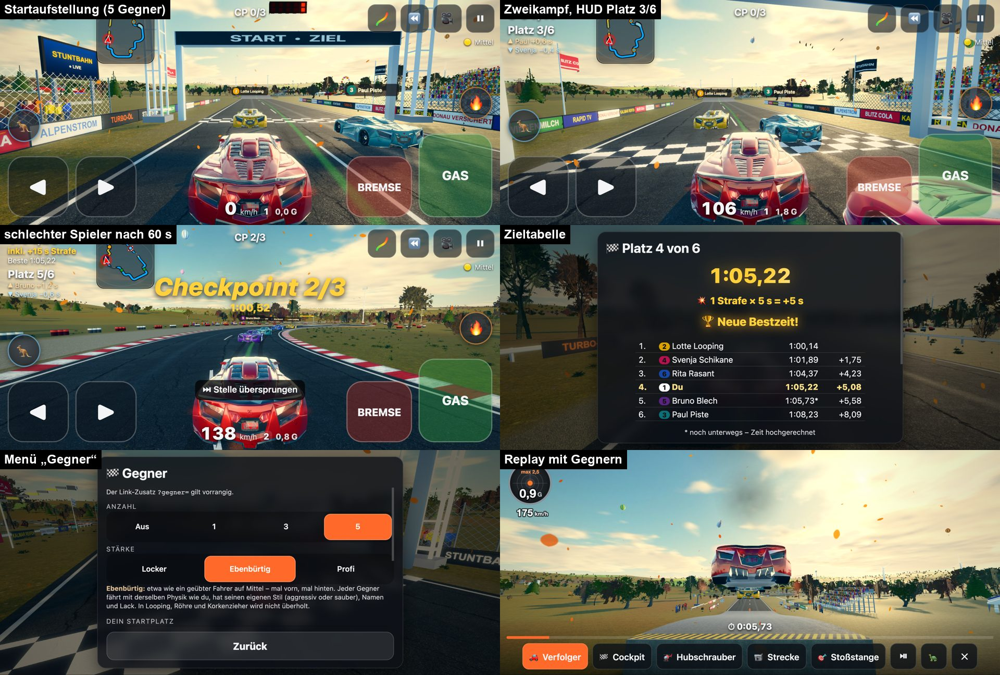
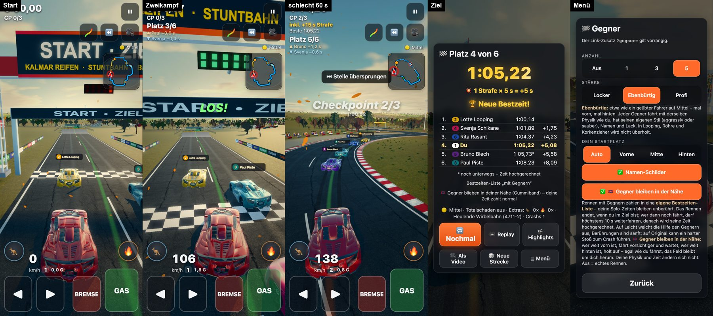
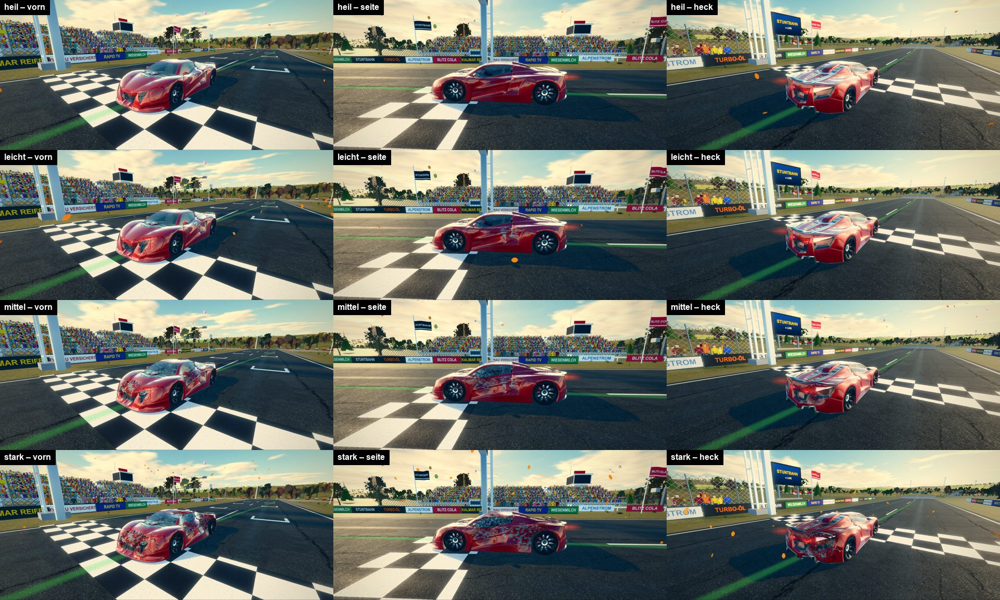
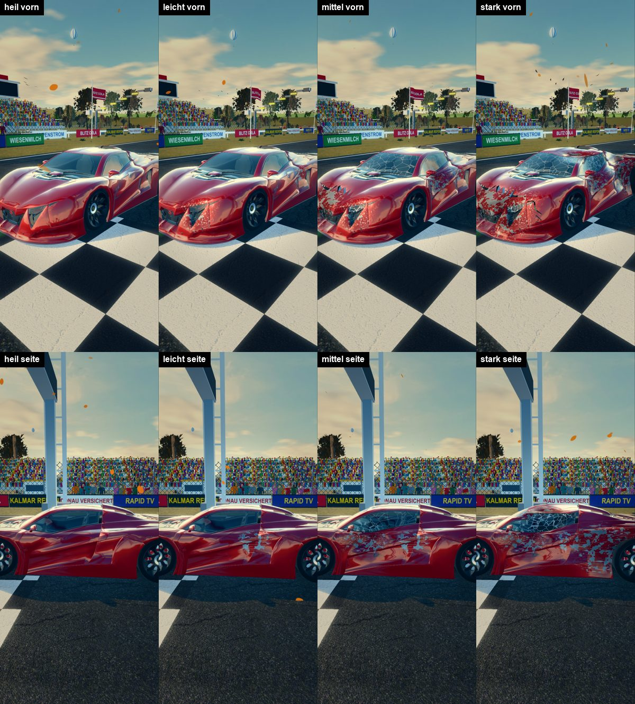

# n34 – KI-Gegner, Gummiband und Schadensmodell (Bericht)

Stand 18.10.2026 · Version **0.10.1** · live: https://drpeterkalmar.github.io/stuntbahn/ · Port-Notiz: `GEGNER.md`

Peter 08.10.: „stuntbahn mit optionalem multiplayer oder npc-gegnern“ (dieser Job: NPC-Gegner, Multiplayer folgt als n35) und
„wir brauchen dann ein schadensmodell“. 15.10.: „egal wie schlecht man fährt, die npc Gegner sollten immer in der Nähe bleiben
damit es nicht frustrierend wird“.

**Ablauf:** Vorbau ohne Browser auf rog17 (Leicht-Spur, Branch `vorbau/stuntbahn-n34-gegner`, 20 Commits, Übergabe
`VORBAU_stuntbahn-n34-gegner.md` – hier eingearbeitet und entfernt), dann am Mac: Vorher-Messung auf main (8039d4c), Merge,
Browser-Abnahme, Anpassung an n37 (Arcade-Physik), n38 (Abklingzeit, Zwischenzeiten) und n39 (Minikarte), Gummiband nach Peters
Nachtrag, Schadens-Optik, Mess-Gate.

## Ergebnis in Kürze
| Ziel (Brief) | Ergebnis |
|---|---|
| Menü „🏁 Gegner“ Aus/1/3/5, Stärke, URL, gemerkt | ✓ `?gegner=3&staerke=profi`, Startplatz, Namen-Schilder, „🪢 Gegner bleiben in der Nähe“ |
| Gegner mit echter Physik + menschlichen Fehlern, Persönlichkeit, Lack, Nummer, Name | ✓ dieselbe `car.js`-Physik **inkl. Arcade-Physik der Stufe** (n37); Fehler-Plan je Seed; 8 fiktive Fahrer |
| Auto-Auto-Kollision weich/hart, Funken + Ton, kein Durchrutschen | ✓ Quader-Trennachsen-Test, Swept-Test; Funken bei Stoß **und beim Schleifen**, Crash-Ton nach Entfernung |
| Startraster, gemeinsamer Countdown | ✓ 2er-Reihen versetzt (Bild unten) |
| HUD Platz + Abstände, Schilder, Zieltabelle, 10-s-Nachlauf | ✓ |
| Fahrhilfen fair, kein Überholen in Stunts | ✓ Leicht weicht aus und kommt per „Geduld“ vorbei (Hände weg: Platz 1 von 6 gegen 5 × Locker); Not-Deckel in der Stunt-Anfahrt; Gegner machen Platz |
| Eigene Bestzeiten-Liste „mit Gegnern“, Geist + Gegner | ✓ auch HUD „Beste“ und Zwischenzeiten (n38) aus dieser Liste |
| Replay/Highlights mit Gegnern | ✓ 15-Hz-Aufzeichnung, Nitro-Flammen im Replay |
| Gummiband Standard an, Gegner immer in der Nähe (Nachtrag 15.10.) | ✓ mit Einschränkungen (Tabelle unten) |
| KI nutzt Nitro/Hüpfer mit derselben Abklingzeit (Nachtrag 15.10.) | ✓ Nitro (`COOLDOWN`); Hüpfer bewusst nicht (Risiko ohne Gewinn) |
| Minikarte: Gegner als farbige Punkte (Nachtrag 10.10.) | ✓ Lackfarbe, vor dir größer |
| Node: 60 Strecken × 3 Stärken, alle im Ziel, Reihenfolge, Profi ± 5 % | ✓ 360/360 im Ziel, Reihenfolge 60/60 (Mittel und Original), Profi 59/60 bzw. 60/60 |
| „Gegner Aus“ bitgleich und zeitgleich | ✓ 12 Rennen bitgleich zu main 8039d4c; Bildzeit −8 … +7 % (Rauschen) |
| Mess-Gate 5 Gegner ≤ +15 % p95 | **teilweise:** Kino 5 von 6 Messungen ✓ (eine +26 %), Standard +17 … +44 % ✗, Einfach +22 … +61 % ✗ |
| Schadensmodell (Dellen, Teile, Optik, Fahrfolgen, Option) | ✓; Mess-Gate Schaden ≤ +5 %: Standard ✓ (+4 … +6 %), **Kino ✗ (+13 … +22 %)** → Standard bleibt „Aus“ |

## 1. Gegner auf der n37-Physik (Brief-Nachtrag 10.10.)
Der Vorbau kannte n37 nicht: seine Gegner fuhren mit der Physik der Prüffahrt (keine Arcade-Wand, alte Crash-Schwellen). Jetzt
bekommt jedes Gegner-Auto `Race.carAssist(…, Stufe des Spielers)` – Wand schrammt, Crash-Schwellen, Mittel-Antrieb mit Deckel,
Landehilfe – ohne Luft-Tricks. Die Schiene außer Sicht rechnet mit demselben Antrieb (`antrieb()`), sonst war sie auf Mittel 4 %
schneller als die Physik. `?gegnerphysik=roh` = Vorbau.

`node tools/gegner_mess.mjs` (60 Sammlungs-Strecken, gleichmäßig aus 250; je Strecke 1 Gegner je Stärke; Zeit zur Autopilot-
Prüffahrt):

| | Vorbau (rog17, roh) | **Mittel (Endstand)** | **Original (Endstand)** |
|---|---|---|---|
| im Ziel | 180/180 | 180/180 | 180/180 |
| Locker | +35,9 % | +35,5 % (10–90 %: +29 … +43) | +35,5 % |
| Ebenbürtig | +14,9 % | +15,8 % | +13,9 % |
| Profi | +0,8 % (60/60 in ± 5 %) | +3,4 % (59/60) | −0,3 % (60/60) |
| Reihenfolge Locker > Ebenbürtig > Profi | 60/60 | 60/60 | 60/60 |
| Crashs | 3 | 1 | 2 |

Profi auf Mittel +3,4 %: das Mittel-Höchsttempo ist gedeckelt (n37) – derselbe Deckel gilt für den Spieler; mit Nitro (Gegner
zünden mit Abklingzeit) wurden aus +5,0 % +3,4 %. **5er-Feld Ebenbürtig** (60 Strecken): 300/300 im Ziel, +21,6 % (Gedränge),
15 Crashs (Vorbau 22), davon Zusammenstoß 6 (Vorbau 15), Stöße in Looping/Röhre/Schanze 0. **Schiene ↔ Physik** (20 Strecken,
ohne Fehler): −1,5 % (−4,4 … +1,3 %), Rechenzeit 3,06 → 0,16 ms je Auto-Sekunde.

**Wie stark fühlen sich die Stufen an?** Vergleich auf 10 Sammlungs-Strecken mit dem Mittel-Bot „mensch-handy“ aus n37 (Handy-
Reaktion, grobe Lenkstufen, Bremshinweis) und einem fehlerfreien Mittel-Fahrer:

| | Autopilot | fehlerfrei Mittel | Locker | Ebenbürtig | Profi | mensch-handy |
|---|---|---|---|---|---|---|
| Zeit (× Autopilot, Spanne) | 1,00 | 1,04 … 1,06 | 1,31 … 1,45 | 1,12 … 1,22 | 1,03 … 1,06 | 1,42 … 2,21 |

Profi ≈ ein fehlerfreier Mittel-Fahrer, Ebenbürtig ≈ ein geübter, Locker ist für einen sauberen Fahrer schlagbar; ein
ungeübter Handy-Spieler ist langsamer als Locker – dafür ist das Gummiband da.

## 2. Gummiband „Gegner bleiben in der Nähe“ (Nachtrag 15.10., Standard an)
Statt der Vorbau-Stufe (±5 % ab 120/160 m, Standard aus) ein **stetiger Regler** je Gegner aus dem Streckenweg-Abstand d zum
Spieler (`AUFHOL` in `ai/gegner.js`): Totband ±30 m, vorn Faktor 1 − (d − 30)/80 m, hinten 1 + (−d − 30)/140 m, weich gefiltert
(1,5 s, bremsend 3 s). Grenzen **in Sicht** 0,3 … 1,15 (nie über das Profil-Tempo, in Looping/Röhre/Korkenzieher/Schanze und
ihrer Anfahrt immer 1, nie unter einem vorab gerechneten Mindest-Tempo vor jedem Stunt), **außer Sicht** (Schiene) 0,05 … 1,45 –
dort wartet ein Gegner praktisch. Beim Wechsel Schiene → Physik wird das Tempo aufs Profil geklemmt. Die letzten 350 m vor dem
Ziel des Spielers hört das Aufholen von hinten auf (ein guter Spieler gewinnt klar); Gegner vorn bleiben gebunden. Spieler-
Physik und -Zeit unverändert, Kennung `gb` an Bestzeit/Leicht-Zeit, Hinweis 🪢 in der Zieltabelle. `?aufholhilfe=0`, `?gummi=0…2`.

Probe `node tools/gummiband_probe.mjs` (von Hermes übernommen und erweitert): 6 Strecken (S11/2, S4711/3, S77/2, S5/1, S2024/3,
S303/2) × Locker/Ebenbürtig/Profi × Spieler (Mittel, Autopilot-Lenkung) Tempo × 1,0 / 0,7 / 0,5 und „Crash-Spieler“ (× 0,7 +
erzwungener Crash alle 25 s), 3 Gegner, Start Mitte. Der Spieler **sieht den Verkehr** (weicht aus wie die Leicht-Hilfe, inkl.
„Geduld“ – ein Mensch fährt nicht blind auf); Endstand, Gummiband aus → **an**:

| Spieler | nächster Gegner ≤ 100 m (Ø / schlechtestes Rennen) | nächster Gegner max | Feldspitze max vor dir | Sieger-Vorsprung ohne deine Strafzeit (max / Ø) | Platz Ø | Gegner-Crashs |
|---|---|---|---|---|---|---|
| gut (× 1,0) | 76 % / 30 % → **77 % / 36 %** | 648 → **365 m** | +127 → **+74 m** | 3,2 / −7,5 → **−1,0 / −5,8 s** (du gewinnst) | 1,2 → **1,0** | 1 → 2 |
| mäßig (× 0,7) | 96 % / 73 % → **99 % / 83 %** | 172 → **234 m** | +803 → **+234 m** | 30,0 / 13,8 → **11,8 / 0,0 s** | 1,8 → 1,4 | 4 → 6 |
| schlecht (× 0,5, 2,3–2,9 × Autopilot-Zeit) | 70 % / 19 % → **92 % / 73 %** | 1032 → **265 m** | +1311 → **+320 m** | 88,2 / 56,1 → **14,5 / 4,6 s** | 3,7 → 3,6 | 24 → 36 |
| Crash-Spieler | 88 % / 50 % → **97 % / 92 %** | 603 → **173 m** | +1073 → **+358 m** | 43,4 / 25,9 → **19,2 / 5,6 s** | 4,0 → 4,0 | 4 → 7 |

Zielwerte Hermes: **≤ 100 m in ≥ 85 %** ✓ mäßig/schlecht/Crash-Spieler, ✗ guter Spieler (77 %: „Locker“ fällt hinter ihm zurück –
gewollt, ein guter Spieler soll gegen Locker klar gewinnen); **max ≤ 220 m** ✓ nur Crash-Spieler (sonst 234–365 m, kurzzeitig);
**Feldspitze ≤ +250 m** ✓ gut/mäßig, ✗ +320/+358 m beim schlechten und Crash-Spieler (kurzzeitig, meist in Stunts, wo Gegner
ihr volles Tempo fahren müssen und ein × 0,5-Spieler am meisten verliert); **Sieger ≤ ~15 s vor einem schlechten Spieler** ✓
ohne dessen Strafzeit (mit Strafzeit bis 40 s – 5 s je Crash gleicht kein Gummiband aus). Gegner-Crashs steigen beim schlechten
Spieler 24 → 36: das sind überwiegend die geplanten Fehler („Stunt verpatzt“) – mit Band fahren die Gegner dort in voller Physik
statt pauschal auf der Schiene. Gegenprobe mit **blindem** Bot-Spieler (fährt auf alles auf): ≤ 100 m gut 69 → 76 %, mäßig
88 → 98 %, schlecht 67 → 88 %, Crash 69 → 96 %; Gegner-Crashs gut 5 → 5, schlecht 26 → 41 (Auffahren des Bots).
Rohdaten: `tests/out/n34/gummiband_endstand.txt` (lokal), Aufruf `node tools/gummiband_probe.mjs 0|1 --sieht=0|1`.

**Leicht „Hände weg“** (Vorbau-Probe `tools/gegner_spieler_probe.mjs`, 5 × Locker, Start hinten): vorher Platz 2 bzw. 3 von 6,
jetzt **Platz 1 von 6** auf beiden Strecken – dank „Geduld“: hängt der Leicht-Spieler > 2 s hinter einem Gegner fest (in 24 von
40 s war die Strecke voraus zu schmal zum Überholen), lässt der ihn vorbei (etwas langsamer, zur Seite) und Leicht darf sanft
anstupsen. Der Verkehr kostet trotzdem Zeit gegenüber solo (111/117 s statt 90/94 s).

Unterwegs gefundene und behobene Fehler (Probe/Diagnose `tools/gummiband_probe.mjs`):
- Gegner fuhren in der Stunt-Anfahrt ungebremst auf einen kriechenden Spieler auf (Vorbau: dort bewusst kein Folge-Deckel) →
  **Not-Deckel** (nur Mindestabstand). Zusammenstoß-Crashs beim × 0,5-Spieler ohne Band 40 → 2.
- Die menschliche Brems-Reaktion (Locker 0,35 s) galt auch fürs Bremsen hinter einem Auto → Verkehrs-Bremsen mit 0,08 s.
- Nach Schiene → Physik trug ein Gegner noch den Schienen-Faktor 0,05 → kroch sichtbar und wurde gerammt → sofort geklemmt.
- Rundkurs: Gegner quer übers Feld in Sicht, aber 500 m voraus, fuhren in der Physik weiter → Schiene auch nach Streckenweg.
- Ein schnellerer Spieler fuhr oft auf → Gegner machen ihm auf allen Stufen Platz (Mittel/Original ab 4 m/s schneller, oder
  wenn er schon 1,2 s direkt hinter ihnen hängt, bis 45 m – sonst kam ein Spieler, der den Verkehr respektiert, an „Locker“ nie vorbei).
- Geist-Phase 1,5 s nach jedem Reset/Rückspulen (keine Auto-Auto-Kollision, solange jemand nah ist).
- „Festgefahren“ hinter einem stehenden Spieler → Warten im Verkehr zählt bis 15 s nicht.

Browser: Bild „schlechter Spieler nach 60 s“ (unten): Feld direkt vor ihm, 5 Punkte auf der Minikarte, HUD „Platz 5/6, Bruno
+1,2 s“.

## 3. Browser-Abnahme (Vorbau-Etappen 1–5)
`tests/gegner_shots.py quer|hoch`, `tests/test_gegner_ui.py`, Live-Prüfung `tests/live_check_n34.py`. Ein Browser, stumm, 0 JS-
Fehler. Korrigiert nach dem Bild:
- Lacke zu grell (Paul „Bonbon-Hellblau“) → satte, dunklere Lacke wie die Spieler-Farben (alte Werte im Kommentar).
- Zieltabelle: zwei Fußnoten übereinander (die Ergebnis-Karte stauchte Zeilen statt zu scrollen) → behoben.
- Gegner-Blatt hochkant: „Automatisch“ lief in den Nachbarknopf → „Auto“.
- Minikarte ohne Gegner → Punkte (n39-Schnittstelle), Zwischenzeiten (n38) und HUD „Beste“ aus der Liste „mit Gegnern“.
- Gegner-Crashs ohne Ton → Krach nach Entfernung (bis 90 m).

Nicht eigens geprüft: Kino-Replay-Kameras mit Gegnern (Replay ja), LOD-Wechsel im Flug, Namensschilder nachts.

## 4. Schadensmodell (Nachtrag 08.10.)
**Asset-Recherche** (Sketchfab-API, nur downloadbar, Lizenz aus der API; Hermes-Vorrecherche 08.10. bestätigt): Kein freies
Supersportwagen-Modell mit getrennten Teilen oder Schadens-Stufen. Der Goblin selbst liegt nur einmal vor („Fictional supercar –
V12 Goblin“, ollitei, CC BY, 86 623 Flächen; die zweite Fundstelle von basheerkhannj99 ist ein identischer Re-Upload). Gefundene
Wracks (Demolition Derby Car, jeandiz, CC BY, 201k; Crashed Abandoned Car, rashad-brahimli, CC BY, 8,3k; Destroyed Car 03,
kryik1023, CC BY, 10k) taugen höchstens als Deko/Referenz. Für Kratzer/Ruß/Glasbruch: Poly Haven (CC0) geprüft – „Blue Metal
Plate“ (Rob Tuytel) zeigt Blechplatten mit Nähten, keine einzelnen Kratzer, als Decal unbrauchbar; ambientCG antwortete nicht.
**Deshalb prozedural:** keine neue Asset-Datei, keine Lizenzfrage (Vermerk in `assets/LICENSES.md`: Goblin zur Laufzeit zerlegt).

Umsetzung (Vorbau + Abnahme):
- **Dellen** (Vorbau): radial mit glattem Rauschen, Tiefe ≤ 16 cm, Summe ≤ 20 cm, nie in den Innenraum, Normalen nachgezogen,
  über mehrere Bilder verteilt (1 ms je Bild). Gegner nur nah (LOD 0).
- **Teile** (Vorbau): Spiegel, Abrisskante, Stoßstangen, Haube fallen nach Treffer-Summe ab und fliegen als Trümmer (6 s).
- **Neu: Optik im Shader** (`gfx/schadenlook.js`): rund um jede Delle Kratzer (Schleifspuren längs), abgeplatzter Lack bis aufs
  Blech mit heller Grundierung am Rand, Ruß bei harten Treffern und über dem Motor ab ~70 %, Klarlack an den Stellen weg; Scheibe
  mit Sprüngen ab ~30 % Gesamtschaden, nah am Treffer feiner. Je Auto ein Uniform-Satz aus dem kompakten Zustand (n35-tauglich).
- **Neu: Kratzer beim Schrammen** an Wand/Leitplanke (n37 schrammt statt Crash): je 0,35 s Schleifen über 6 m/s ein ganz flacher
  Treffer (Test).
- **Neu: Funken beim Schleifen** zweier Autos (Seite an Seite).
- Rauch ab 70 %, Fahrfolgen nur „Mit Fahrfolgen“ + Original + Totalschaden (ab 60 % Ziehen/weniger Leistung, 100 % Wrack), Reset
  repariert nicht, neues Rennen schon, Rückspulen spult mit (Vorbau, Node-Tests).

**Standard bleibt „Aus“:** Der Schadens-Zusatz im Lack-Shader kostet auf Grafik „Kino“ Bildzeit, selbst wenn nichts beschädigt
ist (A/B: ohne Zusatz ±0 %, mit +13 … +22 % p95; schon die Treffer-Schleife allein +10 % – vermutlich Register-Druck im großen
Kino-Lack-Shader). Deshalb wird er nur übersetzt, wenn Schaden in den Optionen an ist (Entscheidung beim Rennstart, nie mitten im
Rennen); mit „Aus“ ist der Shader exakt wie vor n34. Standard-Grafik mit Schaden: +4 % (heil) / +6 % (stark beschädigt) ✓.
BeamNG-artige Soft-Body-Verformung geht im Browser nicht – die Dellen sind eine Näherung.

## 5. Mess-Gate „Mittelklasse-Android“ (CPU ×4, DPR 2,6, 412×915 hoch / 915×412 quer, ungedeckelt)
`tests/perf_gate.py --szenen tests/perf_szenen_gegner.json --ab vorher=<main 8039d4c>:: --ab aus= --ab g5=&gegner=5&staerke=ebenbuertig
--runden 3`. p50 / p95 in ms; Spalte „aus“ in Klammern = zu vorher, „5 Gegner“ in Klammern = zu aus. start = Pulk direkt nach
dem Start (alle in voller Physik und im Bild), mitte = nach 25 s (mit Gummiband: Feld weiter beisammen).

| Szene | Gerät | vorher (main) | Gegner Aus | 5 Gegner | Δ p95 | ≤ +15 % |
|---|---|---|---|---|---|---|
| start_kino | quer | 8,7 / 12,1 | 8,7 / 11,8 (−2 %) | 11,4 / 14,9 (+26 %) | +3,1 ms | ✗ |
| start_kino | hoch | 8,6 / 12,6 | 8,8 / 12,6 (+0 %) | 11,0 / 14,2 (+13 %) | +1,6 ms | ✓ |
| mitte_kino | quer | 9,2 / 13,0 | 9,2 / 12,8 (−2 %) | 10,8 / 14,4 (+12 %) | +1,6 ms | ✓ |
| mitte_kino | hoch | 12,3 / 32 | 11,8 / 32,2 (+1 %) | 12,8 / 32,6 (+1 %) | +0,4 ms | ✓ (Lauf gestört) |
| replay_kino | quer | 8,6 / 11,0 | 8,8 / 11,2 (+2 %) | 9,7 / 12,5 (+12 %) | +1,3 ms | ✓ |
| replay_kino | hoch | 8,1 / 10,3 | 8,1 / 10,5 (+2 %) | 8,6 / 10,5 (+0 %) | +0,0 ms | ✓ |
| start_standard | quer | 5,3 / 7,4 | 5,0 / 6,8 (−8 %) | 7,4 / 9,8 (+44 %) | +3,0 ms | ✗ |
| start_standard | hoch | 5,0 / 7,3 | 5,0 / 7,3 (+0 %) | 6,0 / 8,8 (+21 %) | +1,5 ms | ✗ |
| mitte_standard | quer | 5,3 / 7,5 | 5,6 / 7,9 (+5 %) | 6,8 / 9,3 (+18 %) | +1,4 ms | ✗ |
| mitte_standard | hoch | 5,5 / 8,1 | 5,6 / 8,1 (+0 %) | 6,8 / 9,5 (+17 %) | +1,4 ms | ✗ |
| start_einfach | quer | 3,4 / 5,1 | 3,2 / 4,9 (−4 %) | 5,3 / 7,9 (+61 %) | +3,0 ms | ✗ |
| start_einfach | hoch | 3,2 / 5,3 | 3,1 / 5,0 (−6 %) | 4,9 / 7,7 (+54 %) | +2,7 ms | ✗ |
| mitte_einfach | quer | 3,7 / 5,9 | 4,1 / 6,3 (+7 %) | 5,3 / 8,0 (+27 %) | +1,7 ms | ✗ |
| mitte_einfach | hoch | 3,5 / 5,4 | 3,3 / 5,1 (−6 %) | 4,2 / 6,2 (+22 %) | +1,1 ms | ✗ |

(Kino und mitte_einfach aus Lauf 2 nach dem Schadens-Shader-Fix, die übrigen aus Lauf 1 – dort war „Gegner Aus“ wegen des
damals immer übersetzten Schadens-Shaders auf Kino +4 … +20 %; mit dem Fix −2 … +2 %.)

**Ehrlich:** 5 Gegner kosten absolut **+1,1 … +3,1 ms p95** je Bild. Auf „Kino“ (Bilder ~9–12 ms) liegt das meist im Gate, auf
Standard/Einfach (ungedeckelt nur 3–5 ms je Bild) prozentual weit darüber. Zerlegt (start_einfach, A/B mit Mess-Reglern):
Logik + Physik der Gegner (Darstellung aus, `?gegnervis=0`) ≈ +1,25 ms, Darstellung ≈ +1,6 ms. Was half: nicht aktive LOD-Stufen
der Gegner aus dem Szenengraph gehängt, Echtzeit-Schatten nur der Karosserie (statt 14 Teilen), auf „Einfach“ Fern-Modell ohne
Schatten, halber Physik-Takt ohne Nachbarn (60 Hz, gleiche Rundenzeiten). Was nicht half: Räder je Material zu einem Skinned-Mesh
bündeln (12 → 2 Draw-Calls; Skinning-Shader und abgeschaltetes Frustum-Culling fraßen den Gewinn – wieder ausgebaut).
Einordnung: Mit V-Sync (60 Hz, 16,7 ms Budget) bleiben alle Szenen weit unter dem Budget; das Gate misst ungedeckelt. Mehr
ginge nur mit weniger Gegnern auf schwachen Geräten oder Gegnern ohne volle Physik in der Nähe (dann keine echten Stöße) – nicht
umgesetzt, Peter entscheidet. Mess-Regler zum Nachmessen: `?gegnervis=0`, `?gegnerlod=0|1|2`, `?gegnerschatten=0`,
`?gegnerraeder=0`, `?gegnertakt=voll|halb`, `?schadenlook=0`, `?looklack=0`, `?lookglas=0`, `?schadenprobe=1`.

## 6. Tests
- Node (alle 55 Dateien der Suite grün): neu `test_autoauto` (25), `test_gegner` (72, inkl. Gummiband: Spieler steht 40 s →
  Feldspitze +200 m statt +729 m; Faktor in Sicht nur 0,3 … 1,15; Optionen), `test_gegner_gfx` (16), `test_schaden` (33, inkl.
  Kratzer beim Schrammen), `test_schaden_gfx` (9; Häppchen-Prüfung entflakt). „Gegner Aus“ bitgleich: Referenz auf main 8039d4c
  neu erzeugt (`tools/gegner_aus_hash.mjs`), 12 Rennen gleich.
- Browser: `tests/test_gegner_ui.py` (Leicht/Mittel/Original je 3 Gegner, HUD, Minikarte, Arcade-Physik, Gummiband-Schalter,
  `?aufholhilfe=0`, Gegner Aus; 21 Prüfungen grün), `test_minikarte_ui.py` grün, `test_extras_ui.py`: „kleinq“-Überlappung
  Tacho ↔ Bremse rot – **schon auf main vor n34 rot** (geprüft im Arbeitsbaum 8039d4c), nicht von n34.
- Messung: `tools/gegner_mess.mjs` (60 Strecken), `tools/gummiband_probe.mjs`, `tests/perf_gate.py` (oben).

## 7. Grenzen / offen
- Mess-Gate Gegner auf Standard/Einfach und Schaden auf Kino verfehlt (siehe 4 und 5).
- Gummiband beim sehr schlechten Spieler: Feldspitze kurzzeitig bis +330 m, nächster Gegner bis 254 m.
- Gegner nutzen keinen Hüpfer; keine Luft-Tricks (Stunt-Punkte gibt es nur für den Spieler).
- Rennen sind eine Runde (Fehler-Plan, Ziel); Kollisionskörper ist ein Quader (Spiegel/Spoiler ragen nicht heraus).
- Wechsel der Fahrhilfe im Pause-Menü ändert Härte und Gegner-Physik erst im nächsten Rennen.
- Peters Handy-Test steht aus: Fühlt sich „Ebenbürtig“ ebenbürtig an? Ist das Band zu stark/schwach (`?gummi=0.5|1.5`)?

## 8. Hinweise für n35 (Online-Mehrspieler)
Fremde Autos = `GegnerVis` mit Netz-Lage; Kollision `stoss(…, { festB: true })`; Rangliste/Raster `rennfeld.js`; Schaden als
`packen(S)` (3 + 8 Byte je Delle) übertragen, Optik folgt über `schadenZeigen`. Gummiband nur für KI-Gegner, nie für Menschen.
