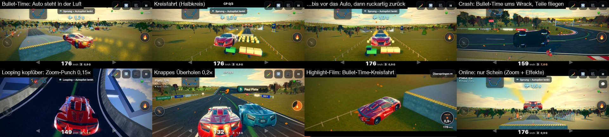

# n36 – Action-Momente: Zoom-Punch, Speed-Ramp und Bullet-Time live im Rennen (Bericht)

Stand 20.10.2026 · Version **0.12.0** · live: https://drpeterkalmar.github.io/stuntbahn/
Peter 09.10.: „Schnelle Zoom-ins auf die Szene mit Effekten und Speed-Ramps … oder Bullet-Time! Das wäre auch in Stuntbahn
cool.“ Bisher gab es Zeitlupe nur im Highlight-Film nach dem Ziel – jetzt gibt es kurze Kino-Momente **mitten in der Fahrt**.
Aufgesetzt auf n33 (Hindernisse), n34 (KI-Gegner + Schaden), n35 (Online), n37–n39 (Arcade-Physik, Stunt-Lohn, Minikarte).

## 📱 Handy-Test für Peter
1. Link öffnen, **⚙️ Optionen → 🎬 Action-Momente → „Oft“** (zum Ausprobieren; Standard ist „Selten“).
2. Strecke **`4711-2`** (Code eingeben bzw. `?seed=4711&d=2`), Leicht reicht. Gleich nach dem Start kommt eine Schanze:
   Am höchsten Punkt **friert das Bild ein** – kurzer Weißblitz, schwarze Kino-Balken oben/unten, das Auto hängt in der Luft,
   die Nitro-Flammen stehen still, die Kamera fährt in ~1 s im **Halbkreis um das Auto** bis vor die Motorhaube – dann
   ruckartig zurück hinter das Auto, kurzes Wackeln, weiter geht's.
3. Mit **Gegnern** (🏁 Gegner 3) gibt es Zeitlupe beim **knappen Überholen** (Bild zoomt ran, Blick zum Überholten), auf
   Strecken mit **Looping** (z. B. `?seed=1000&d=3`) oben **kopfüber**.
4. **Mittel:** In der Bullet-Time kurz **Gas antippen** – der Salto-Wunsch wird angenommen (die Uhr oben läuft im Moment nur
   ganz langsam mit, du verlierst nichts).
5. Gefällt dir die Dosierung? „Selten“ ≈ alle 2–3 Minuten ein Moment, „Oft“ ≈ einmal pro Minute. **⚡ Blitze reduzieren**
   in den Optionen nimmt den Weißblitz raus.
6. Nach dem Ziel im **Highlight-Film**: Der große Sprung kommt als Standbild mit Kreisfahrt (dort auch nach Online-Rennen).

## Ergebnis in Kürze
| Ziel (Brief) | Ergebnis |
|---|---|
| Auslöser großer Sprung → Bullet-Time (Airtime ≥ 1,5 s, Kamera halb um das Auto, Teilchen stehen) | ✓ am Scheitel, erwartete Flugzeit aus Höhe über der Fläche darunter; Staub/Funken/Flammen/Regen/Trümmer laufen mit 0,03× (stehen), Regen ohne Schlieren |
| Looping-Scheitel/Korkenzieher kopfüber | ✓ (`kopf`: Looping, Korkenzieher, Wendel, Röhre mit Wand; je Stück einmal) |
| Knappes Überholen (n34) | ✓ (`vorbei`: Fortschritt wechselt, ≤ 3,4 m, ≥ 54 km/h) |
| Crash/Überschlag mit abfallenden Teilen, Bullet-Time ums Wrack, dann normal/Respawn | ✓ (`crash`; Teile zählen ×1,5; das Aufblitzen vor dem Fahrbahn-Reset kommt erst nach dem Moment) |
| Landung nach Rekordsprung | ✓ (`landung`: weitester Sprung des Rennens ≥ 1,3 s) |
| Zieleinlauf Foto-Finish | ✓ (`ziel`: ≤ 0,4 s vor der Linie, Gegner ≤ 0,8 s dran bzw. Bestzeit ± 0,4 s) |
| Nachtrag Vorlagen-Datenblatt: Stunt-Ketten, Takedowns/Beinahe-Treffer, Landeschub | ✓ `kette` (≥ 3 Glieder), `takedown` (Gegner crasht ≤ 3 s nach deinem Rempler), Landeschub ×1,5, Spektakel-Faktoren Luft ×2, Dreher ×2, Frontal ×2, Deckel ×8, ruhige Hand ×1,5 (Bullet-Time bevorzugt ab 2,0 s Luft) |
| Online nur Schein, echte Bullet-Time im Highlight-Replay | ✓ Physik online immer 1×, nur Zoom-Punch + Effekte; Momente gehen als Marken in den Film → Standbild mit Kreisfahrt |
| Speed-Ramp 1× → 0,1× → 1,5× → 1× / Zoom-Punch / Bullet-Time ≤ 0,05× | ✓ Tiefpunkt je Art 0,12–0,3× (Looping 0,15×), danach kurz 1,5×; Bullet-Time 0,03× (Crash 0,04×) |
| Live-Moment ≤ 1,2 s, Bullet-Time ≤ 1,5 s | ✓ Live 0,8–1,2 s, Bullet-Time 1,4 s (gemessen längste Zeitlupe 1,38 s) + 0,28 s Wackeln in Echtzeit |
| Abkühlzeit ≥ 8 s, Zufall + Spektakel-Wertung | ✓ Selten 20 s, Oft 8 s; p = min(1, Wertung/6) × (Selten 0,55, Oft 1) |
| Menü „🎬 Action-Momente: Aus / Selten / Oft“ (Standard Selten), `?action=0` | ✓ Optionen + Pause, gespeichert; `?action=0|1|2` geht vor |
| Fair: Eingaben in der Zeitlupe, Physik nur langsamer, Bullet-Time setzt exakt fort | ✓ gleiche Physikschritte (Rennzeit mit = ohne: 24/24 Mess-Vergleiche + 4/4 im Node-Test), Tipp-Speicher; Browser: Gas-Tipp in der Bullet-Time angenommen |
| Nie, wenn sofort reagiert werden muss | ✓ nicht bei „Bremsen!“ bzw. wenn das Brems-Profil in den nächsten max(30 m, 1,7 s) unter 85 % des Tempos fällt (Kurven, Zickzack, Bauwerk-Einfahrten); Bullet-Time am Sprung nur mit ≥ 0,6 s Fallzeit danach |
| Effekte: Weißblitz, Radial-Blur/Speed-Lines, Sättigung + Vignette, leichte Chromatic Aberration, Shake, Blitze reduzieren | ✓ im Kino-Look-Shader (Variante nur während eines Moments), Grafik „Einfach“ per CSS (Blitz, Vignette, Tempo-Streifen); Kino-Balken auf allen Stufen; „Blitze reduzieren“ (auch „Bewegung reduzieren“ des Systems) → Blitz 0,08 statt 0,5 |
| Bildfolgen ≥ 12 je Moment als Collage, vision_analyze ≥ 8/10 | ✓ 13–18 Bilder je Moment (8 Collagen); vision_analyze stand nicht zur Verfügung → selbst angesehen: **8/10**, Bullet-Time klar erkennbar (unten) |
| Häufigkeit je Rennen messen | ✓ Tabelle unten (`tools/action_mess.mjs`) |
| Eingabe-Test während Zeitlupe | ✓ `tests/test_action_ui.py` |
| Bildrate Handy ≥ 30 fps | ✓ im Handy-Profil (CPU ×4 gedrosselt, DPR 2,6) p95 ≤ 10,1 ms während Momenten am Stück (≈ 99 fps); **kein echtes Handy** getestet |
| Version, README, Changelog, Bericht, live | ✓ 0.12.0, README-Abschnitt, neu `CHANGELOG.md`, dieser Bericht, live geprüft |

## Wie es gebaut ist
- **`src/game/action.js`** (rein rechnerisch, in Node getestet): `ACTION` (alle Zahlen), `tempoBei` (Tempo-Kurve),
  `fxBei` (Effekte je Zeitpunkt), `spektakel` (Wertung), `gefahrVoraus`, `ActionRegie` (Takt, Auslöser aus Zustand und
  Ereignissen, Dosierung, Kamera: Halbkreis mit Seitenwahl und Verdeckungs-Prüfung, Zoom-Punch mit Blick zum Auto/Fokus,
  Wackeln).
- **`main.js`:** `acc += rdt × Spieltempo × physK` – die Physik macht dieselben festen 1/120-s-Schritte, nur seltener.
  Tipps zwischen zwei Schritten (in der Bullet-Time liegen ~17 Bilder dazwischen) werden gemerkt und im nächsten Schritt
  gegeben. Welt-Uhr (Wind, Wellen, Regen) und Teilchen/Trümmer laufen mit `physK`; Motor-Ton tiefer, „Stinger“ beim Start.
  Kamera: erst die normale Kamera, dann die Regie darüber (am Ende springt sie zurück – „ruckartig“). Cockpit: Kreisfahrt
  zeigt das Auto von außen, Zoom-Punch nicht (festes Sichtfeld gegen Übelkeit), Effekte schon.
- **`kinolook.js`:** Variante `ACTION` des Endbilds (Radial-Unschärfe zum Auto, Farbsäume am Rand, Sättigung, Vignette);
  nur während eines Moments, beim Laden vorübersetzt (sonst stockte das erste Moment-Bild: 417 + 178 ms → 7 ms).
- **`highlights.js`:** `HL.bullet` – Momente mit Bullet-Time (`marks.action`) bekommen im Film ein Standbild von 1,2 s mit
  Kreisfahrt (höchstens 2 je Film); ohne solche Marken wird das Rekord-Standbild eines großen Sprungs/Crashs zur Bullet-Time.
- **`ai/gegner.js`:** Stoß-Ereignis kennt jetzt den Gegner (`id`) und „frontal“ (für den Takedown).
- **UI:** Optionen/Pause-Segment, Schalter „⚡ Blitze reduzieren“, `#actfx` (Kino-Balken, CSS-Effekte), Hinweis- und
  Checkpoint-Zeile treten in der Bullet-Time zurück (Knöpfe bleiben bedienbar).

## Häufigkeit (tools/action_mess.mjs 2: 18 Zufallsstrecken flach/Hochstraße/Gelände × Stufe 1–3, Rennen in 60-Hz-Bildern)
„leicht“ = Autopilot Leicht, „profi“ = Mittel wie der Autopilot mit Salto-Tipp; Gegner = 3 × Ebenbürtig.

| Stufe | Gegner | Fahrer | Momente/Rennen | je Minute | Zeitlupe an der Fahrzeit | Kandidaten/Rennen | abgelehnt (Zufall · Gefahr · Abkühlen) |
|---|---|---|---|---|---|---|---|
| Selten | 0 | leicht | 0,50 | 0,38 | 0,7 % | 2,3 | 15 · 7 · 10 |
| Selten | 0 | profi | 0,50 | 0,37 | 0,7 % | 2,2 | 13 · 4 · 13 |
| Selten | 3 | leicht | 0,56 | 0,42 | 0,7 % | 3,3 | 20 · 18 · 11 |
| Selten | 3 | profi | 0,83 | 0,60 | 1,0 % | 3,2 | 21 · 6 · 16 |
| Oft | 0 | leicht | 1,17 | 0,88 | 1,6 % | 2,3 | 4 · 2 · 14 |
| Oft | 0 | profi | 1,06 | 0,77 | 1,4 % | 2,2 | 5 · 2 · 13 |
| Oft | 3 | leicht | 1,44 | 1,08 | 1,9 % | 3,3 | 5 · 11 · 17 |
| Oft | 3 | profi | 1,56 | 1,12 | 1,8 % | 3,2 | 10 · 5 · 15 |

Je Art (Oft, 3 Gegner, profi): Looping 10/16, Bullet-Time 8/9, Überholen 8/18, Landung 1/9, Foto-Finish 1/1, Kette 0/5
(Ketten folgen fast immer direkt auf einen Sprung-Moment → Abkühlzeit). Rennzeit mit Momenten = ohne in allen Stichproben.
Erste Messung mit Selten 0,5 / 14 s ergab fast dasselbe wie Oft (Abkühlzeit dominierte) → Selten auf 0,55 / 20 s gestellt.

## Bildfolgen (tests/action_shots.py → tests/shots/action/collage_*.jpg)
| Moment | Bilder | Collage |
|---|---|---|
| Bullet-Time am Sprung (4711-2, natürlich ausgelöst) | 18 | `collage_bullet.jpg` |
| Looping kopfüber (1000-3, natürlich) | 14 | `collage_kopf.jpg` |
| Knappes Überholen (2024-2, 3 Gegner, natürlich) | 13 | `collage_vorbei.jpg` |
| Crash/Überschlag mit Beulen und fliegenden Teilen (Überschlag nachgestellt, Auslösung über das echte Crash-Ereignis) | 14 | `collage_crash.jpg` |
| Foto-Finish (erzwungen auf der Geraden – Auslöser natürlich nur in Node gemessen) | 13 | `collage_ziel.jpg` |
| Grafik „Einfach“ (CSS-Effekte) | 14 | `collage_einfach.jpg` |
| Online (Mess-Probe, Schein: Physik 1×) | 13 | `collage_online.jpg` |
| Highlight-Film: Bullet-Time-Standbild mit Kreisfahrt | 16 | `collage_film.jpg` |

**Bewertung (selbst angesehen, Frage „wirkt filmisch-spektakulär, Bullet-Time erkennbar?“): 8/10.** Die Bullet-Time ist
eindeutig: Auto und Flammen stehen in der Luft, die Kamera umrundet es, Balken und kräftige Farben geben Kino-Gefühl, der
Sprung zurück sitzt. Der Looping-Zoom wirkt wuchtig, das Überholen mit beiden Autos groß im Bild ebenfalls. Abzüge: Die HUD-
Knöpfe bleiben sichtbar (müssen bedienbar bleiben), die Minikarte liegt im Bild; die Farbsäume waren im ersten Wurf viel zu
stark (Regenbogen-Ränder) und sind jetzt dezent.

## Bildrate (tests/perf_gate.py, Handy-Profil: CPU ×4 gedrosselt, DPR 2,6, quer; Mitte des Rennens, Moment nach Moment)
| Grafik | ohne Moment p50/p95 | Bullet-Time am Stück | Zoom-Punch am Stück |
|---|---|---|---|
| Kino | 8,4 / 11,1 ms | 7,7 / 10,1 ms | 7,8 / 10,5 ms |
| Standard | 4,8 / 6,6 ms | 4,1 / 5,6 ms | 4,1 / 5,8 ms |
| Einfach | 3,2 / 4,7 ms | 2,7 / 4,2 ms | 2,8 / 4,5 ms |
Momente kosten nichts Messbares (in der Zeitlupe rechnet die Physik weniger, das gleicht den Effekt-Durchgang aus). Erst-
Ruckler beseitigt (Vorübersetzen). ≥ 30 fps (≤ 33 ms) überall weit eingehalten – gemessen am Mac mit Handy-Profil, nicht am
echten Handy.

## Tests
- `node tests/node/test_action.mjs` (in `npm run test:node`): Kurven, Dauer, Effekte, Blitze reduzieren, Dosierung,
  Takedown, Online-Schein, Kamera-Halbkreis (freie Seite, nie unter dem Boden), Rennen mit Gegnern (Momente kommen,
  Rennzeit gleich, Mittel mit Eingaben schrittgleich), Film mit Bullet-Time-Standbild. Alle 63 Node-Tests grün.
- `python3 tests/test_action_ui.py`: Optionen (Standard Selten, Oft speichern, Schalter Blitze), Bullet-Time auf Mittel,
  Gas-Tipp angenommen, Rennuhr +0,025 s in 0,68 s, Pause hält den Moment, Effekte danach aus, `?action=0`, keine Fehler.
- Gegenproben: `tests/smoke.py`, `tests/test_kinoreplay.py` (quer + hoch) grün.

## Grenzen / offen
- **Foto-Finish und Takedown** im Browser nur erzwungen bzw. über den Ereignis-Weg geprüft; natürliches Foto-Finish nur in
  Node (1–3 je 18 Rennen mit Gegnern). Takedowns kamen in den Mess-Rennen nicht vor (Ebenbürtig-Gegner crashen selten nach
  Remplern) – Node-Test prüft den Weg.
- **Stunt-Kette** löst praktisch nie aus (fällt fast immer in die Abkühlzeit nach dem Sprung-Moment) – gewollt, sonst kämen
  zwei Momente kurz hintereinander.
- **Wrack nachsteuern in der Crash-Zeitlupe** (Vorlage D, Burnout) nicht gebaut – in der Bullet-Time steht die Physik fast,
  Lenken wirkt dort bewusst nicht anders als sonst.
- Der Brief nennt „wenn ein Gegner am Ball dicht vor dem eigenen Tor steht“ – das gehört zu einem Ballspiel und hat in der
  Stuntbahn keine Entsprechung; umgesetzt ist die Regel als „nie vor Kurven/Hindernissen/Bremsstellen“.
- Online-Film mit Bullet-Time: Marken werden auch online gesetzt; im Browser habe ich den Film nach einem echten Online-Rennen
  nicht abgespielt (offline geprüft).
- Wechselt die Grafik-Automatik mitten im Rennen die Stufe, wird die Effekt-Variante dieser Stufe beim nächsten Moment einmal
  übersetzt (kurzer Ruckler möglich).
- Kein Test auf einem echten Handy (Bildrate im Handy-Profil gemessen).
