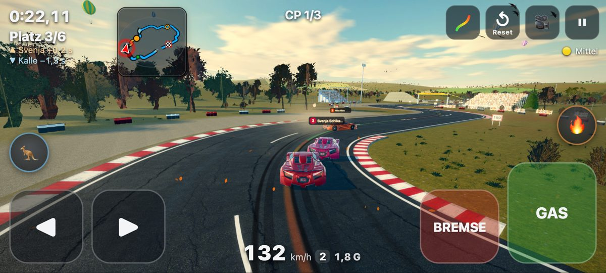
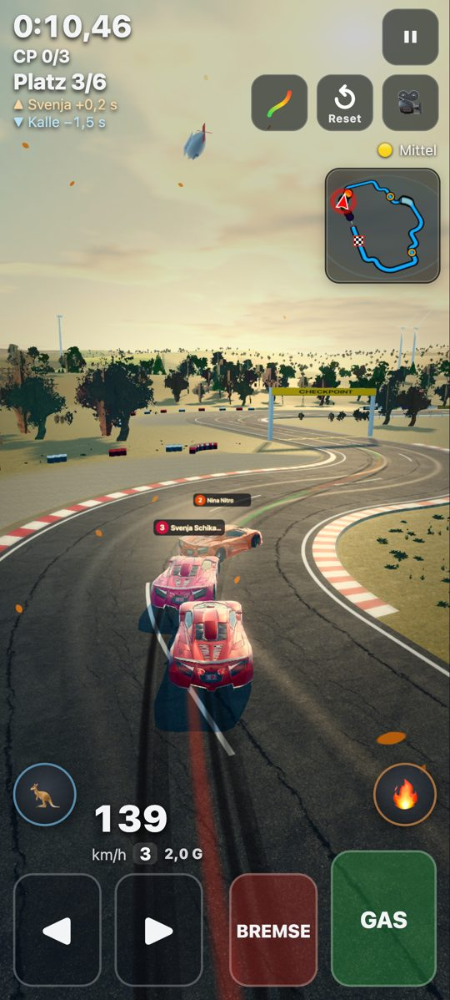

# n43 – Gegner fahren besser, alle Autos driften mehr (Bericht)

Stand 01.11.2026 · Etappe 1 = **0.17.0**, Etappe 2 = **0.18.0** · live: https://drpeterkalmar.github.io/stuntbahn/

Peter 01.11.: „stuntbahn: alle drei gegnerstufen fahren besser. alle autos driften mehr.“

## Kurz
- **Gegner** (alle drei Stufen) sind deutlich schneller und sauberer: eigenes Kurven-Profil je Stärke, seltener verbremst/verpatzt,
  kürzere Reaktion, in Kurven auf der Ideallinie, Ebenbürtig/Profi überholen mutiger. Mittel: Locker +20 % (vorher +36 %),
  Ebenbürtig +8 % (+16 %), Profi −0,3 % (+3,4 %) zur Autopilot-Zeit – Reihenfolge auf 60/60 Strecken.
- **Gegner driften jetzt** (vorher nie): Locker in 49 %, Ebenbürtig 46 %, Profi 30 % der Kurvenzeit quer, mit Gummispuren und
  Reifenqualm, nie in Looping/Röhre/Korkenzieher/Schanze/Steilkurve.
- **Leicht-Autopilot „Brachial“** driftet mehr: 52 % statt 28 % der Kurvenzeit quer, 10,6 statt 6,4 Drifts je Runde.
- **Spieler-Auto** mit lockererem Heck (Einlenk-Ruck, Lastwechsel, Bremsimpuls, Vollgas in der Kurve), auf Mittel mit Drift-Hilfe.
  **Bestzeiten bleiben gültig** (Sauber-Autopilot ±0,3 %). Auf Original deutlich mehr Drift; auf Leicht/Mittel bewusst vorsichtig
  (siehe „Frage an Peter“).

## Etappe 1 – Gegner fahren besser (0.17.0)
`node tools/gegner_mess.mjs` (60 Sammlungs-Strecken, 1 Gegner je Stärke, Zeit zur Autopilot-Prüffahrt; Endstand inkl. Drift):

| | 0.16.0 Mittel | **jetzt Mittel** | 0.16.0 Original | **jetzt Original** | Ziel (Mittel) |
|---|---|---|---|---|---|
| Locker | +35,5 % (29 … 43) | **+20,2 %** (16 … 26) | +35,5 % | **+20,0 %** | +18 … 22 % ✓ |
| Ebenbürtig | +15,8 % | **+7,9 %** (5,7 … 10,1) | +13,9 % | **+6,3 %** | +6 … 9 % ✓ |
| Profi | +3,4 % | **−0,3 %** (−1,8 … 1,5) | −0,3 % | **−1,5 %** | −2 … +1 % ✓ |
| Reihenfolge | 60/60 | **60/60** | 60/60 | **60/60** | ≥ 95 % ✓ |
| Crashs (180 Rennen) | 1 | **1** | 2 | **2** | nicht mehr ✓ |
| Stöße in Stunts | 0 | **0** | 0 | **0** | 0 ✓ |
| Rechenzeit je Auto | 1,83 ms/s | 1,79 ms/s | 1,75 | 1,73 | ≤ +20 % ✓ |

- **Wie:** `STAERKEN` in `src/ai/gegner.js` (alte Werte `STAERKEN_ALT`): neu `kurve`/`brems` = eigenes Kurven-Profil mit der
  Reifenhaftung der Fahrhilfe (Mittel hat 30 % mehr Grip – bisher fuhren die Gegner das vorsichtige Profil der Prüffahrt; selbst ein
  fehlerfreier Profi kam so nur auf +2,9 %). In Looping/Röhre/Schanze fahren sie weiter genau das Prüffahrt-Tempo. Dazu weniger
  Verbremser/Patzer, kürzere Reaktion, `streuKurve` (Ideallinie in Kurven), `mut` (Überholen, nicht auf Hochstraßen).
- **Profi gegen Brachial auf Original** (`tools/n43_brachial_vgl.mjs`): Profi im Mittel 3 % langsamer als der Brachial-Autopilot,
  nur auf sam-015 klar schneller (das war schon in 0.16.0 so: dort verliert Brachial Zeit).
- **5er-Feld** (60 Strecken × 5): Crashs gesamt 67 → 61 (Locker 42 → 32, Profi 10 → 6, **Ebenbürtig 15 → 23**: meist „Abgestürzt“/
  Zusammenstoß im Pulk – ohne Drift ebenfalls 23, liegt am höheren Tempo). Stöße in Stunts 0.
- **Aufholhilfe** nachgestimmt (Gegner vorn bremsen früher: `AUFHOL` vorL 55, physVor 0,2, tauVor 2). `tools/gummiband_probe.mjs`,
  Spieler × 0,5: Sieger ohne Strafzeit max 12,0 s (0.16.0: 14,5 s), nächster Gegner ≤ 100 m in 90 % der Zeit. Leicht „Hände weg“
  gegen 5 × Locker mit Aufholhilfe: Platz 1/6 auf beiden Probe-Strecken (ohne Aufholhilfe jetzt Platz 2 – Locker ist ein echter Gegner).
- Grenzfall: Spieler bleibt 40 s am Start stehen → Feldspitze +294 m statt +200 m (der schnellere Profi nimmt mehr Schwung in den
  ersten Looping mit, dort greift das Band bewusst nicht).
- `?gegnerstaerke=alt` = Werte von 0.16.0 (mit `?gegnerdrift=0` bitgleich: 6 Rennen + 12 Rennen mit Aufzeichnung geprüft).

## Etappe 2 – Alle Autos driften mehr (0.18.0)
### Gegner driften
Die Drift-Logik von „Brachial“ (`ai/drift.js`) steuert jetzt auch jeden Gegner (`GEGNER_DRIFT` in `ai/gegner.js`): gleiche
Drift-Stellen (nie in Stunts, Steilkurven, Engstellen, Hochstraßen ohne Bande), je Stärke dosiert. Schleuderschutz und
Traktionskontrolle der Stufe ruhen im Drift (die TCS nahm sonst fast den ganzen Hinterrad-Antrieb – Profi verlor 6 %). Kein Drift
neben einem anderen Auto, erst ab 54 km/h, Beinahe-Dreher nur mit Abstand zum Rand. Deterministisch je Seed (Online gleich).

`node tools/drift_mess.mjs --gegner=locker,ebenbuertig,profi --n=42` (Mittel; Original in Klammern):

| | Kurvenzeit > 10° | Drifts/Runde | größter Winkel | Zeit zur Prüffahrt | Crashs/10 Runden | Drift in Stunt-Zonen |
|---|---|---|---|---|---|---|
| Locker | **49 %** (52 %) | 10,6 | 69° | +18 % | 0,2 (0) | 0 s |
| Ebenbürtig | **46 %** (48 %) | 8,8 | 44° | +6 % | 0,2 (0) | 0 s |
| Profi | **30 %** (33 %) | 6,6 | 22° | −1,7 % | 0 (0) | 0 s |

Ziel ≥ 30 % (Profi ≥ 20 %) ✓. Die Tempo-Faktoren sind so nachgestimmt, dass die Etappe-1-Zeiten trotz Drift halten (Tabelle oben =
Endstand mit Drift). Gegner zeigen jetzt Gummispuren und Reifenqualm (bis 140 m bzw. 70 m zur Kamera, `?gegnerfx=0` = aus). Die
„Schiene“ außer Sicht rechnet den Drift-Zeitverlust ein (Schiene ↔ Physik −0,5 %, vorher −1,5 %).

Selbst angesehen: der orange Gegner steht quer in der Kurve, lange schwarze Gummispuren, kein Auto in der Wand; Qualm ist nur
schwach zu sehen (heller Himmel).

### Leicht-Autopilot „Brachial“
`node tools/drift_mess.mjs --n=42`, 4 Seeds = 168 Runden: Kurvenzeit > 10° **28 % → 52 %** (Ziel ≥ 50 % ✓), Drifts je Runde
**6,4 → 10,6** (≥ 9 ✓), Crashs **0,4 je 10 Runden** (≤ 1 ✓), Schanzen **124/124 ok** ✓. Rundenzeit −8 % zu Sauber (vorher −10 %).
Wie: mehr Drift-Kurven (Radius bis 150 statt 75 m, kleinere Abstände zu Stunts), jede Drift-Kurve wird gedriftet, schneller quer,
später eingefangen, straffere Spurführung, Neuansatz nach einem Rand-Abbruch (vorher brach jeder 2. Drift am Rand ab und die Kurve
war verloren). `?brachial=alt` = Werte bis 0.17.0.

### Spieler-Auto (alle Fahrhilfen)
Neu in `physics/car.js` `HECK` (nur Spieler-Autos, nie Prüffahrt/Generator, nie Gegner): die Hinterachse verliert kurz Haftung bei
**Einlenk-Ruck** (Lenkung springt), **Lastwechsel** (Gas schlagartig weg in der Kurve), **Bremsimpuls** in der Kurve, **Vollgas in
der Kurve**; ein schon querstehendes Heck bleibt mit Vollgas länger draußen. Ein weich fahrender Spieler löst das kaum aus – darum
bleiben Bestzeiten gültig. **Mittel** zusätzlich mit **Drift-Hilfe**: ein solcher Ruck stellt das Heck kontrolliert ~15° quer
(Drift-Regler) und fängt danach sicher ein. Gesperrt vor/in Stunts, Steilkurven, Engstellen, auf Hochstraßen.

`node tools/n43_spieler_drift.mjs --n=42 --fahrer=glatt,mensch,vollgas` (alt = 0.17.0 → neu):

| Stufe / Fahrer | Kurvenzeit > 10° | Crashs je 10 Runden | Rundenzeit |
|---|---|---|---|
| Leicht · glatt (Sauber-Autopilot, Bestzeit-Maßstab) | 0,1 → 0,1 % | 0 → 0 | **+0,01 %** ✓ |
| Leicht · mit Lenk-Tipps | 0,4 → 0,8 % | 1,2 → 1,4 | +0,7 % |
| Mittel · glatt (Autopilot-Eingaben) | 0 → 0 % | 0 → 0 | **0,00 %** ✓ |
| Mittel · Handy (digital, Lenk-Stufen) | 0 → 0,5 % | 1,9 → 2,4 | +0,8 % |
| Mittel · Vollgas-Spieler | 0 → 0,9 % | 1,4 → 2,1 | +0,8 % |
| Original · glatt | 0 → 0 % | 22,6 → 21,9 | **−0,3 %** ✓ |
| Original · Vollgas-Spieler | 1,6 → **12,1 %** | 15,0 → 17,1 | +5,4 % |

Bestzeiten-Regel (±2 %) ✓ auf allen Stufen – **keine Bestzeiten gelöscht**. `?drift=alt` = Spieler-Physik 0.17.0 (bitgleich,
geprüft mit den Referenz-Fahrten aus n36/n37/n34), `?heck=0…2` = Stärke.

## Frage an Peter
**Spieler-Drift auf Leicht/Mittel ist bewusst vorsichtig.** Das Mittel-Auto hat so viel Haftungsreserve, dass es nur mit der
Drift-Hilfe quer kommt – und jeder Schritt mehr kostete in der Messung sofort Crashs (Spieler fliegt ab). Mit `?heck=2`:
Mittel-Handy-Spieler 6,4 % der Kurvenzeit quer (statt 0,5 %), aber 4,3 statt 1,9 Crashs je 10 Runden; Original-Vollgas 21 %.
Auf Leicht driftet ohnehin der Standard-Autopilot „Brachial“ (52 %). Bitte am Handy mit und ohne `?heck=2` auf Mittel probieren –
wenn dir das gefällt, mache ich es zum Standard (dann ggf. mit etwas mehr Crash-Risiko).

## Handy-Test
App einmal ganz schließen und neu öffnen (Version 0.18.0).
1. **Gegner:** Menü 🏁 Gegner → 5, Stärke **Locker**, Fahrhilfe Mittel → sie driften wild durch die Kurven (Qualm, Spuren). Dann
   **Profi**: kaum schlagbar, driftet nur kurz in engen Kurven. Vergleich: `?gegnerstaerke=alt&gegnerdrift=0` = wie 0.16.0.
2. **Brachial:** Leicht, Hände weg → fast jede Kurve quer. Vergleich `?brachial=alt`.
3. **Eigenes Auto:** Original, in der Kurve kurz Gas weg oder Bremse antippen → Heck kommt; Mittel: ruckartig einlenken → kurzer
   kontrollierter Drift. Vergleich `?drift=alt`, stärker `?heck=2`.

## Tests und Werkzeuge
- `npm run test:node` grün, neu `tests/node/test_n43.mjs` (Stärken-Reihenfolge, `?gegnerstaerke=alt` bitgleich, Kurven-Profil,
  Gegner-Drift ≥ 30/30/20 %, nie in Stunts, deterministisch, `?gegnerdrift=0`, Bestzeit-Maßstab ±2 %, Heck-Sperre, Drift-Hilfe
  fängt ein). Alt-Tests (n34/n36/n37 bitgleich) laufen mit `STUNT_DRIFT=alt` bzw. `HECK.k = 0`.
- Browser (Pixel 7 quer + hoch, stumm): `python3 tests/n43_shots.py quer|hoch <stärke>` – 0 pageerrors; `tests/test_gegner_ui.py`,
  `tests/smoke.py` 0 Fehler.
- Werkzeuge: `tools/gegner_mess.mjs --set=… --satz=alt --gegnerdrift=0`, `tools/drift_mess.mjs --gegner=… --gdosis=…`,
  `tools/n43_spieler_drift.mjs --hset=…`, `tools/n43_brachial_vgl.mjs`, `tools/gummiband_probe.mjs --aufhol=… --satz=alt`,
  `tools/gegner_spieler_probe.mjs --satz= --aufholhilfe=1`. Rohdaten lokal in `tests/out/n43/`.
