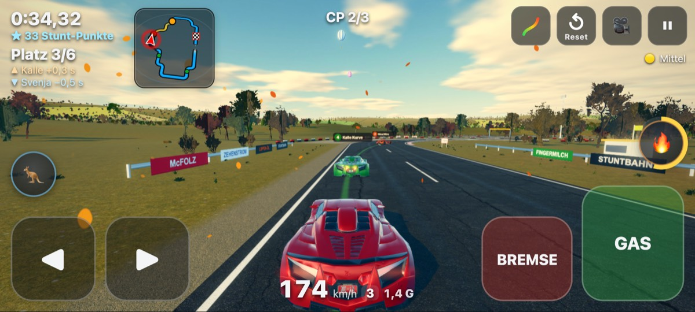
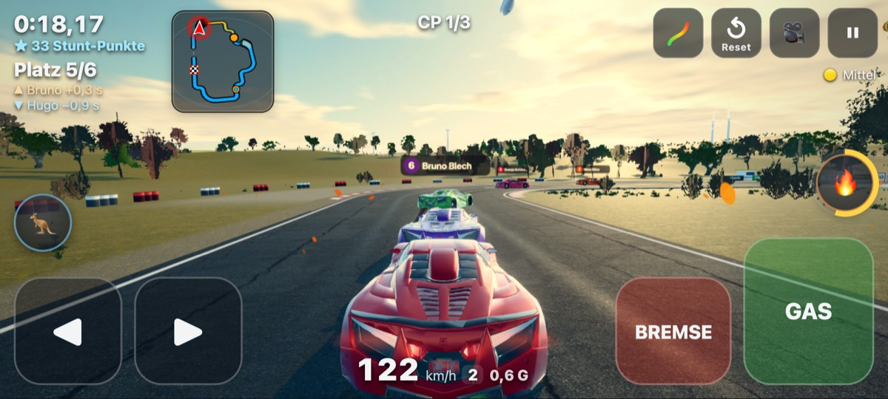
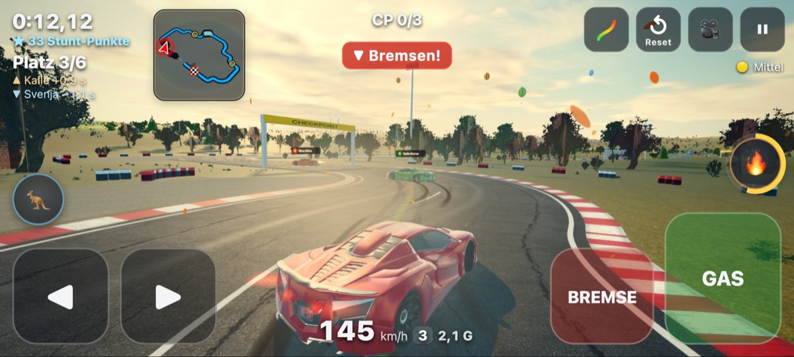
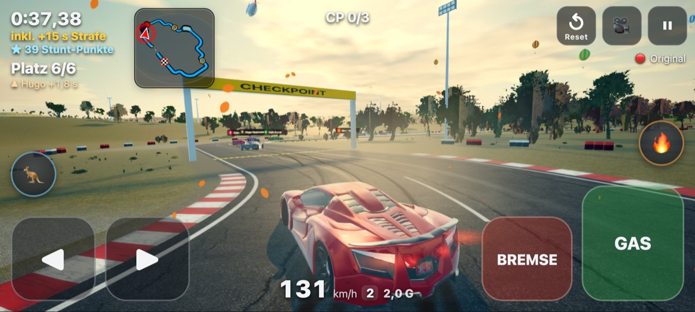
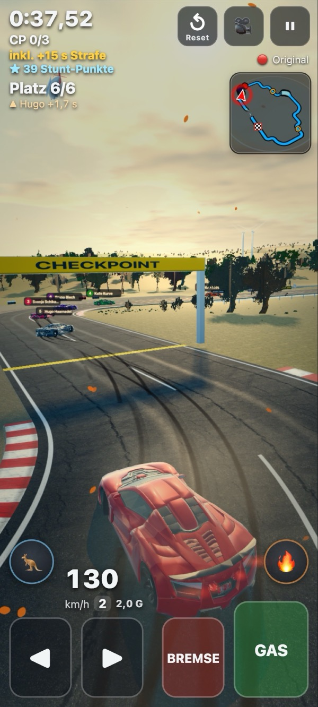
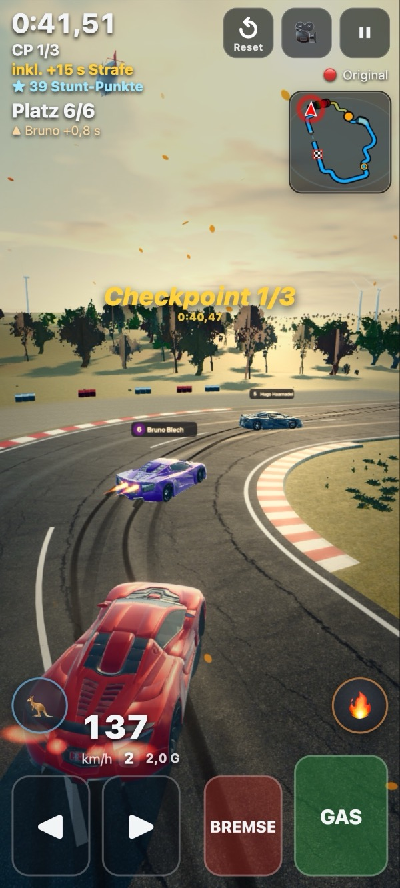

# n45 – Gegner geben Gas, wenn du aufholst · Rempler ohne Sofort-Strafe · sichtbarer Arcade-Drift (Bericht)

Stand 06.11.2026 · Version **0.20.0** · live: https://drpeterkalmar.github.io/stuntbahn/

Peter 04.11.: „bei stuntbahn sollen die npc gegner die auf mich warten etwas beschleunigen wenn ich zu ihnen aufhole sonst gibt es
ständig auffahrunfälle von mir. außerdem soll die strafe für aufpraller nicht so schnell kommen, ein bisschen kontakt darf schon
sein. und die autos (ich auf mittel und schwer, npcs) driften noch immer nicht :(“ – Nachtrag 20:45: „arcade drifting, dass in der
kurve einfach früher das heck ausbricht, aber so steuerbar ist, wie als ob ich nicht driften würde“.

## Kurz für Peter
- **Gegner, die auf dich warten, geben jetzt Gas, wenn du näher kommst.** Sie ziehen schnell auf ungefähr dein Tempo an – auch eine
  ganze Kolonne. Du fährst seltener mit vollem Tempo auf ein fast stehendes Auto.
- **Anstupsen, Schieben, Schleifen kostet keine Strafe mehr.** Funken, Ton und ein Schubs ja – die +5 s gibt es erst bei einem
  wirklich harten Einschlag (etwa doppelt so heftig wie bisher) oder wenn du dabei umkippst/abfliegst. Gilt für dich, die Gegner
  und online gleich. In den Test-Rennen gab es **81 % weniger Strafen** aus Auto-Kontakten.
- **Dein Auto driftet auf Mittel und Original sichtbar** – in jeder zügigen Kurve kommt das Heck raus (meist 15–30°, eng und schnell
  bis 40°), mit Gummispuren, Quietschen und Qualm. **Lenken fühlt sich genau gleich an wie vorher**: gleiche Linie, kein Gegenlenken,
  kein Dreher, keine Zeit verloren. **Die Gegner** stehen in den Kurven jetzt ebenfalls deutlich quer.
- **Bestzeiten bleiben gültig** (die Rundenzeit ändert sich nicht, gemessen ±0,3 %). Nichts gelöscht.
- Wo sehen: einfach ein Rennen auf Mittel oder Original fahren, Kamera hinter dem Auto (nicht Cockpit), mit 3–5 Gegnern.
- Zum Vergleich: `?drift=n43` = Stand vorher (0.19.3), `?aufhol=alt` = Gegner ohne Gas-Geben, `?rempel=alt` = alte Strafe,
  `?arcadedrift=2` = doppelt so quer, `?arcadedrift=0` = aus.
- **Handy: App einmal ganz schließen und neu öffnen** (Version 0.20.0).

## 1. Wartende Gegner beschleunigen beim Aufholen (Etappe 1)
**Ursache (bestätigt):** Das Gummiband (`AUFHOL` in `ai/gegner.js`) bremst einen Gegner vorn bis auf 20 % seines Tempos und nimmt
das Tempo nur mit 1,5 s Filter wieder auf. Die Diagnose der Auffahrer zeigte zusätzlich: **80 % der Fälle „Gegner vorn viel zu
langsam“ waren Kolonnen** – das Ende hängt am wartenden Kopf, der selbst noch 60–120 m weit weg ist und deshalb nicht anzog.

**Neu – Anzug** (`ANZUG`): Wartet ein Gegner vorn (Faktor < 1) und du kommst näher, gilt eine Untergrenze = 97 % (nah) bis 85 %
(70 m) **deines** Tempos, nie über sein eigenes Renntempo (in Kurven/Bremszonen bleibt das Profil die Grenze). Sie greift voll
innerhalb max(70 m, 15 m + Annäherung²/(2 · Beschleunigung)) – bei hoher Annäherung also früher –, weich ausgeblendet über 30 m,
und zählt für die ganze Kolonne vom hintersten Auto. Anstieg τ 0,3 s (vorher 1,5 s), im Anzug abwärts 0,8 s. `?aufhol=alt`.

`node tools/n45_mess.mjs` – 6 Strecken × 3 Stärken × Spieler × 1,0/0,7/0,5/Crash-Spieler × 3/5 Gegner × Mittel/Original = **288
Rennen**, Spieler = blinder Bot (fährt mit Autopilot-Lenkung auf alles auf, wie Vollgas ohne Rücksicht):

| | 0.19.3 | nur Anzug | **Endstand (Anzug + Rempler)** |
|---|---|---|---|
| Auffahr-Kontakte (Front auf Heck, > 1,5 m/s, binnen 1 s = einer) – alle | 1169 | 626 (−46 %) | 1121 (−4 %) |
| … davon hinter **wartenden** Gegnern (Spieler × 0,7 / 0,5 / Crash) | 815 | 297 (−64 %) | 579 (−29 %) |
| **Strafen aus Auto-Kontakt** (Crash „Zusammenstoß“ oder Crash ≤ 1 s nach Kontakt) | **476** | 268 | **92 (−81 %)** |
| Gegner-Crashs „Zusammenstoß“ | 1037 | 734 | 182 (−82 %) |
| Spieler-Crashs gesamt (inkl. erzwungener des Crash-Spielers) | 1438 | 1229 | 1038 |
| Gegner 5–60 m vor dir > 15 % langsamer (außer Kurve/Stunt) | 31,8 % | 21,6 % | 26,2 % |

**Ehrlich:** Das Ziel „Auffahrunfälle −70 %“ ist für die **Unfälle** (mit Strafe) erreicht (−81 %), für die bloßen **Berührungen**
nicht: Weil Rempler nicht mehr crashen, bleiben die Autos im Pulk beisammen statt zurückgesetzt zu werden – es gibt mehr kleine
Kontakte (meist 2–8 m/s, ohne Folgen). Ein großer Teil der Berührungen kommt vom **schnellen** Spieler (× 1,0), der normal fahrende
langsamere Gegner einholt (keine wartenden – dort greift der Anzug bewusst nicht, sonst wäre z. B. „Locker“ nicht mehr zu überholen).
Die Faustregel „nie > 15 % langsamer“ wird nicht immer gehalten (26 % der Zeit statt 32 %): meist Kolonnen-Enden, die bremsen, um
Abstand zum Vordermann herzustellen, und Gegner, die in Kurven driften. Eine Variante mit größerer Reichweite (100 m) brachte
−18 % Berührungen, aber schlechtere „Gegner bleiben in der Nähe“-Werte (Crash-Spieler 85 % statt 90 %, max 292 m) – nicht genommen.

**Gegner bleiben in der Nähe** (`node tools/gummiband_probe.mjs 1`, Abnahme n34, 72 Rennen, Mittel, 3 Gegner):

| Spieler | ≤ 100 m (0.19.3 → jetzt) | schlechtestes Rennen | nächster Gegner max | Stöße mit Spieler |
|---|---|---|---|---|
| gut × 1,0 | 94 → 94 % | 59 → 57 % | 217 → 225 m | 85 → 84 |
| mäßig × 0,7 | 98 → 97 % | 82 → 71 % | 151 → 219 m | 69 → 34 |
| schlecht × 0,5 | 84 → 84 % | 58 → 56 % | 265 → 269 m | 65 → 39 |
| Crash-Spieler | 93 → 90 % | 77 → 67 % | 213 → 236 m | 152 → 47 |

Praktisch unverändert (≤ 100 m in ≥ 85 % außer beim × 0,5-Spieler – das war schon in 0.19.3 so; „nie > 220 m“ war schon vorher
nicht überall erfüllt, jetzt kurzzeitig bis 269 m, meist in Stunt-Zonen, wo Gegner ihr volles Tempo fahren müssen).

## 2. Rempler: ein bisschen Kontakt ist erlaubt (Etappe 2)
**Ursache:** Die Strafe kam fast immer direkt aus der Auto-Auto-Kollision (`physics/autoauto.js`, Crash-Schwelle des Stoß-Tempos):
von 100 Strafen aus Kontakt waren 97 „Zusammenstoß“, nur 3 Folge-Crashs. Schwellen bis 0.19.3: Mittel 16 m/s, Original 9,5 m/s –
auf Original reichte ein Auffahrer mit 34 km/h Unterschied. Wand-/Überschlag-Regeln (car.js) spielten kaum eine Rolle.

**Neu:** Mittel **30 m/s**, Original **19 m/s** (etwa doppelt), Leicht wie bisher nie. Darunter: Funken, Ton, Schubs, Delle, keine
Strafe, kein Reset. Ein Crash braucht einen einzelnen harten Stoß – viele leichte summieren sich nie. Bleibt das Auto nach dem Stoß
liegen/kippt/fliegt ab, greifen die bisherigen Crash-Regeln. Gilt gleich für Gegner und Online (`game/online.js` nimmt dieselbe
Tabelle). `?rempel=alt`.

5er-Feld Ebenbürtig ohne Spieler, 60 Sammlungs-Strecken (`node tools/gegner_mess.mjs --anzahl=5 --staerken=ebenbuertig
--assist=… --rempel=alt|neu`):

| | Mittel 0.19.3 → neu | Original 0.19.3 → neu |
|---|---|---|
| Crashs gesamt | 23 → 15 | 46 → 17 |
| davon „Zusammenstoß“ | 8 → **0** | 33 → **2** |
| Stöße in Looping/Röhre/Korkenzieher/Schanze | 0 → 0 | 0 → 0 |
| Zeit zur Autopilot-Zeit | +13,9 → +13,8 % | +12,6 → +12,0 % |

Swept-Test (kein Durchrutschen) grün, neue Tests in `test_autoauto.mjs` (12 m/s kein Crash, 25 m/s auf Original weiter Crash,
`?rempel=alt` wie früher). Mehrere Kontakte binnen 1 s zählen in der Messung als einer.

## 3. Drift sichtbar machen (Etappe 3)
### a) Befund: warum Peter im Live-Stand 0.19.3 nichts sah
Browser (Pixel 7 hoch + quer, 5 Gegner, normale Verfolger-Kamera, ohne URL-Regler) und Node:
- **Spieler Mittel:** das lockere Heck (n43) reagiert nur auf Ruck-Ereignisse (Lenk-Sprung, Lastwechsel, Bremsimpuls) – bei
  normalem Fahren fast nie. Gemessen über 42 Strecken: **0,2–0,4 % der Kurvenzeit über 12°**; in den Browser-Fotos 0–1°.
  **Original:** 0,3 % (Handy-Fahrer) bis 9 % (Vollgas-Fahrer). Peters „einmal kurz, mit Vollgas auf einer Onramp“ passt genau dazu.
- **Gegner-Drift war aktiv** (Standard an, hängt an keiner Einstellung – frische und alte gespeicherte Einstellungen gleich, nur
  `?gegnerdrift=0` schaltet ab), und gemessen driften sie 30–49 % der Kurvenzeit. Aber: **kein Drift neben einem anderen Auto**
  (Abstand < 8 m, Schutz gegen Unfälle) – im Pulk vor dir, also genau da, wo du sie siehst, driften sie kaum. Dazu sieht man sie
  von hinten: ein Winkel von 20° auf 30 m Entfernung wirkt im Verfolger-Bild klein.

*0.19.3 (`?drift=n43`): eigenes Auto gerade in der Kurve, Gegner im Pulk ebenfalls gerade.*

### b–e) Arcade-Drift (Spieler Mittel/Original, alle Gegner)
`src/core/arcadedrift.js`: **kein Simulations-Drift**, sondern ein Darstellungs-Winkel. Die Physik (Bahn, Lenkung, Kollisions-Quader,
Rundenzeit) bleibt Bit für Bit gleich (Test: Original-Rennen mit und ohne Drift-Darstellung exakt gleiche Zeit und Lage). Zusätzlich
dreht die Karosserie um die Hochachse (Drehpunkt 0,8 m vor der Mitte – das Heck schwenkt aus):
- Winkel aus der Querbeschleunigung (Gierrate × Tempo): ab 2,5 m/s², 5 m/s² → 14°, 12 → 28°, ab 20 → 40°; eingeblendet zwischen 40 und
  54 km/h; Aufbau 0,2 s, zurück 0,3 s. Ein echter Drift-Winkel (Gegner n43) zählt mit – gezeigt wird höchstens der Soll-Winkel.
- Gesperrt (weich auf 0 in 0,15 s): Looping, Röhre, Korkenzieher, Schanzen-Anfahrt/-Lippe/Luft, Zickzack, Steilkurven (Querneigung
  > 0,2), Wellen, Stunt-Bausteine, je 20 m / 0,7 s davor und 12 m danach; Räder in der Luft, Crash, Rückwärts.
- **Kollision:** unverändert der Quader in Fahrtrichtung – der Drift erzeugt keine neuen Wand-/Gegner-Treffer (Crashs unten).
- Qualm, Gummispuren (an den sichtbaren Hinterrädern), Quietschen (70 % Stärke) aus dem sichtbaren Winkel; Vorderräder zeigen in
  die Fahrtrichtung (sichtbares Gegenlenken); **Drift-Kamera** (n25) jetzt auch auf Mittel/Original. Nicht im Cockpit/an der
  Stoßstange (dort würde die Kamera mitdrehen).
- Das **lockere Heck aus n43 ist auf Mittel/Original still** (alter Weg `?drift=n43`, oder ausdrücklich `?heck=…`); Leicht unverändert.

`node tools/n45_drift_mess.mjs --n=42` (42 Drift-Mess-Strecken; Fahrer wie n43; alt = 0.19.3):

| Stufe / Fahrer | Kurvenzeit sichtbar > 12° | > 15° | Ø Winkel | Crashs je 10 Runden | Rundenzeit zu 0.19.3 |
|---|---|---|---|---|---|
| Mittel · glatt (Bestzeit-Maßstab) | 0,0 → **68 %** | 66 % | 21° | 0 → 0 | **±0,00 %** ✓ |
| Mittel · Handy (`mensch`) | 0,2 → **67 %** | 65 % | 20° | 2,4 → 1,9 | −0,7 % |
| Mittel · Vollgas | 0,4 → 67 % | 65 % | 21° | 2,1 → 1,4 | −0,8 % |
| Original · glatt | 0,0 → **68 %** | 66 % | 22° | 21,9 → 22,6 | **+0,27 %** ✓ |
| Original · Handy | 0,3 → **67 %** | 65 % | 22° | 15,2 → 14,8 | ±0,0 % |
| Original · Vollgas | 9,3 → 67 % | 65 % | 22° | 17,1 → 15,0 | −5,1 % |

Ziel ≥ 40 % ✓. Crashs je 10 Runden nicht höher – außer Original glatt +0,7 (Rauschen: ohne das lockere Heck fährt das Auto minimal
anders; Handy- und Vollgas-Fahrer haben weniger Crashs). Original-Vollgas ist 5 % schneller, weil das Heck aus n43 diesen Fahrer
bremste – die Bestzeiten-Regel misst am Sauber-Fahrer (±0,3 %) ✓, **keine Bestzeit gelöscht**.

Gegner (`--gegner=1`, je 1 Gegner in voller Physik, 42 Strecken; Mittel, Original in Klammern):

| | Kurvenzeit > 15° | Ø Winkel in Drift-Kurven | größter Winkel |
|---|---|---|---|
| Locker | 66 % (67 %) | 31° | 74° (n43-Beinahe-Dreher) |
| Ebenbürtig | 66 % (68 %) | 31° | 56° |
| Profi | 63 % (65 %) | 27° | 42° |

Ziel ≥ 40 % > 15° und 20–35° in Drift-Kurven ✓, Reihenfolge Locker > Ebenbürtig > Profi ✓. Die Zeiten der Stufen sind unverändert
(reine Darstellung). Im Sperrbereich (Stunt-Nähe) quer: zusammen ~0,16 s je Rennen – das ist der n43-Drift, der beim Einfangen kurz in
die 20-m-Vorzone reicht, kein Arcade-Winkel.

### f) Sicht-Prüfung (Bilder selbst angesehen, normale Spielkamera, Pixel 7)
`python3 tests/n45_shots.py quer|hoch spieler|gegner medium|original` – 0 pageerrors, 0 JS-Fehler:

 

- Mittel quer (35°): Auto steht klar quer, Heck außen, Vorderräder gegengelenkt, schwarze Spuren; der grüne Gegner davor ebenfalls
  quer mit Spuren. ✓
- Original quer/hoch (24–32°): deutlich quer, Doppelspur der Hinterräder. ✓
- Gegner hoch (Original): lila und blauer Gegner stehen quer in der Kurve, lange Spuren, eigenes Auto ebenfalls quer. ✓
- **Qualm** ist zu sehen, aber bei hellem Himmel dezent (im Drift jetzt etwas dichter). Spuren sind deutlich.
- Frage „steht das Auto sichtbar quer? Qualm/Spuren zu sehen?“: **ja** für Mittel, Original und Gegner → ausgeliefert.

### Bildrate (Handy-Profil Pixel 7, 5 Gegner, Mittel, GPU headless, `python3 tests/perf_n45.py quer|hoch`)
Mit/ohne Darstellung (gleiche Fahrt): quer 19,1 → 19,8 fps, hoch 16,4 → 19,9 fps – im Rauschen, **kein messbarer Verlust** (Ziel
höchstens −5 % ✓). Partikel erreichen im Drift das Budget (260), das ist gedeckelt.

## Grenzen / offen
- **Replay/Kino-Replay** zeigen die echte Lage ohne Arcade-Winkel (die Aufzeichnung enthält nur die echte Lage).
- Online: fremde Menschen-Autos ohne Arcade-Winkel (ihre Lage kommt aus dem Netz); KI-Gegner und das eigene Auto mit.
- Cockpit/Stoßstange ohne Arcade-Winkel.
- Auffahr-Berührungen insgesamt kaum weniger (siehe 1) – folgenlos, aber da.

## Frage an Peter
- Ist dir der Drift so **zu viel oder zu wenig**? `?arcadedrift=0.6` (weniger) bzw. `?arcadedrift=1.5` probieren – ich stelle den
  Standard dann um. Soll das Replay auch quer zeigen?

## Tests und Werkzeuge
- `npm run test:node` grün, neu `tests/node/test_n45.mjs` (Anzug: Auffahren −40 % und Nähe; Rempel-Schwellen; Arcade-Drift:
  Soll-Winkel, Drehpunkt, Physik bitgleich mit/ohne Darstellung, ≥ 40 % sichtbar quer, Rundenzeit ±2 %, Crashs, Gegner ≥ 40 % > 15°,
  Sperrbereich); `test_autoauto.mjs` erweitert; `test_n43.mjs` prüft das lockere Heck über den alten Weg (`?drift=n43`).
- Browser: `tests/n45_shots.py`, `tests/perf_n45.py`, `tests/smoke.py` (0 Fehler).
- Werkzeuge: `tools/n45_mess.mjs [--aufhol=alt] [--rempel=alt] [--q=drift=n43] [--anzug=k:…]`, `tools/n45_drift_mess.mjs`,
  `tools/gummiband_probe.mjs 1 [--anzug=0] [--anzugset=…]`, `tools/gegner_mess.mjs --rempel=alt`. Rohdaten lokal `tests/out/n45/`.
