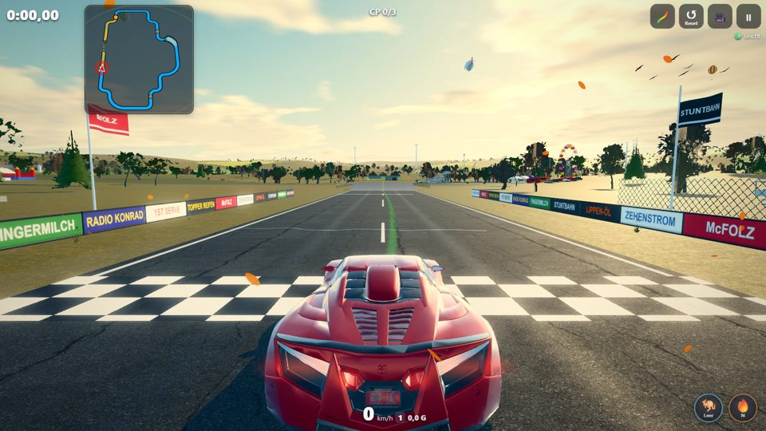
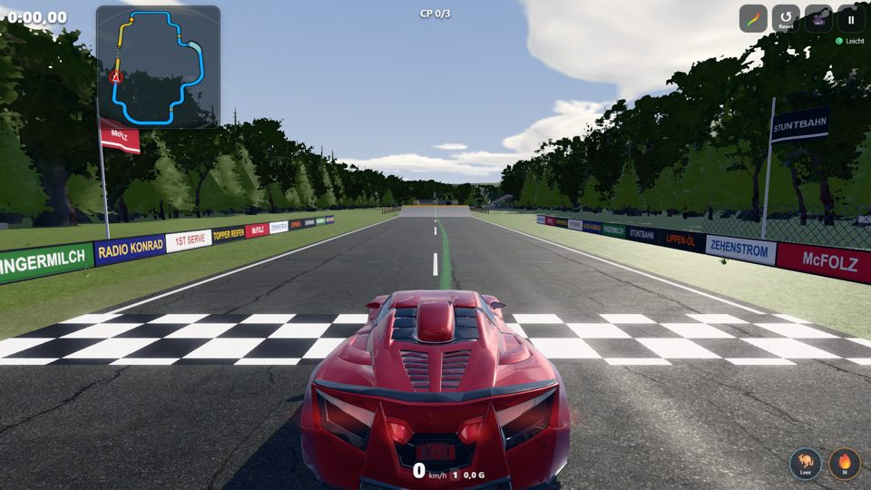
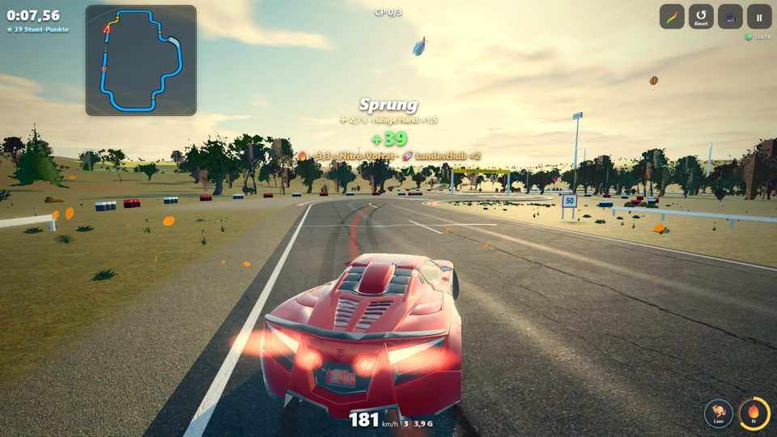
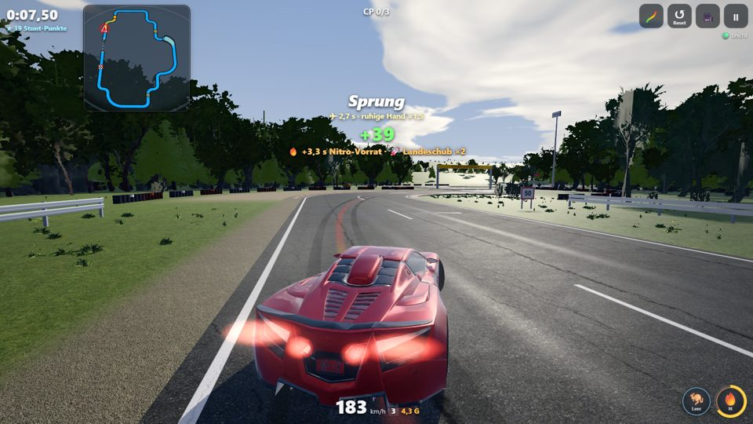
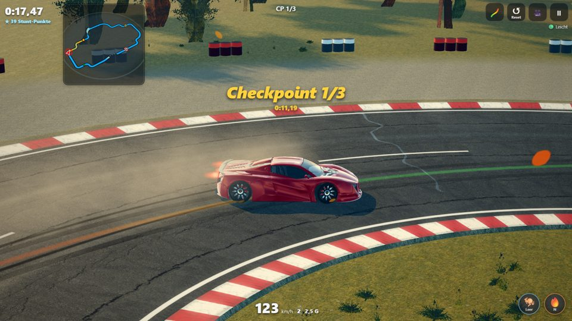
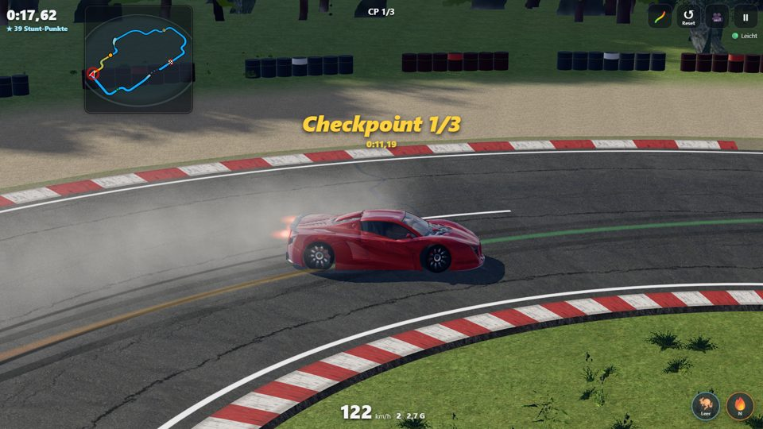
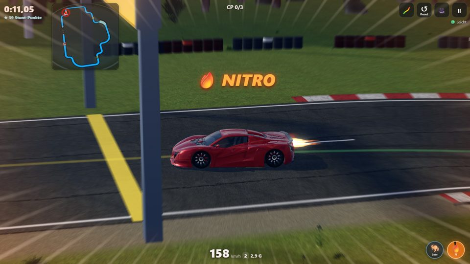
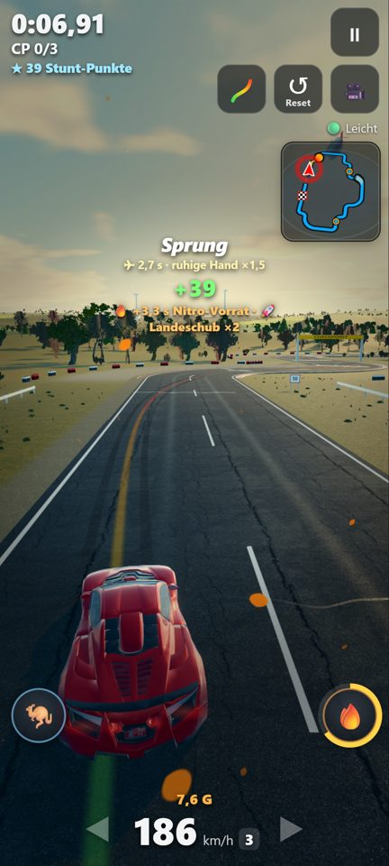
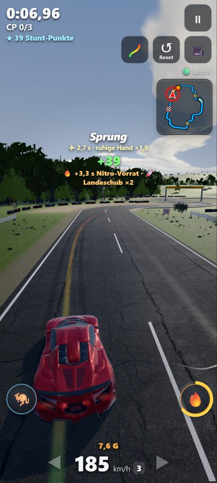

# n47 – Neuer Look nach Vorbild „Uno com escada“ (Version 0.21.0)

Auftrag Peter (18.11.2026): „Stuntbahn soll jetzt so aussehen https://github.com/viktorkav/uno-com-escada“ (Fable-Fassung als
Basis). Gebaut am 20.11.2026 auf rog17 (Windows, RTX 3070 Ti), Zeitfenster ~3 h, Budget sparsam (Opus, 3 Kritiker-Runden).

## Kurzfassung
- Neuer Standard-Look (Land am Nachmittag, Clubkurs): harte Sonne (32°), Himmel mit Cumulus **aus Code** (einmal je Landschaft
  in eine Würfeltextur gebacken), dichter Mischwald 20–80 m neben der Strecke, Rasen statt Blumenwiese, heller matter Asphalt
  mit Gummi-Abrieb, gedämpfte Curbs, doppelte verzinkte Leitplanken, Reifenwände, beiges Kiesbett, neutrales leicht warmes
  Grading ohne Vignette/Flare.
- **📺 TV-Kamera** (Kamera-Wechsel und Replay): ~32 m seitlich, 9 m hoch, Tele ~80 mm, schwenkt mit, ohne Action-Kamera-Effekte.
- `?look=alt` = Look von 0.20.0. Der frühere `?look=alt` (Bild wie bis n22, `post.js`) heißt jetzt `?look=n22`.
- Nur Optik: Bahn, Physik, Gegner und Bestzeiten sind unverändert (Bäume haben keine Kollision, Reifenstapel/Leitplanken sind
  nur Deko; die Position der Reifenstapel bleibt, nur die Wand wird breiter gezeichnet).
- Blinder Bild-Kritiker (frischer Subagent, sieht nur Renders + Vorbild-Screenshots, nie Code): **3/10 → 3,5/10 → 4/10**.
  Ehrlich: Das Vorbild ist ein eigener WebGPU-Renderer mit GI, prozeduraler Vegetation und Gras; mit dem bestehenden
  three.js/WebGL-Weg ist das in einem Abend nur zum Teil erreichbar (siehe „Offen“).

## Vorgehen / Bestand
- Aufgebaut auf Kino-Look (`gfx/kinolook.js`: Tonemapping, Grading, Luftperspektive, Bewegungsunschärfe mit scharfem Auto,
  TAAU) und dem Themen-System (`gfx/themes.js`). Nichts doppelt gebaut: neues Grading `uno` in `GRADES`, Kino-Stufen
  `-vignette,-flare`, Luftperspektive leichter (Dichte 0,00022, max 0,24).
- Neues Modul `src/gfx/uno.js` (Schalter `UNO`, Land-Thema, Licht, Himmel, Laub-Töne). Weichen in `env.js` (Himmel),
  `themes.js`, `materials.js` (Asphalt, Curbs, Baumkarten), `deco.js` (Leitplanken, Reifen, Kies, Gras-Büschel, keine
  Pollen), `kulisse.js` (Laubbäume grün statt Herbst), `track/build.js` (Waldrand), `camera.js` (TV-Kamera), `main.js`.
- „Automatisch“ bei Landschaft/Tageszeit/Wetter = Land, Tag, klar (sonst zeigte die Tagesstrecke z. B. Herbst am Abend).
  Eine Wahl im Menü oder per URL gilt weiter; andere Landschaften behalten ihr Himmelsbild und ihre Sonne.
- Importierte und erzeugte .TRK-Strecken bekommen den Look automatisch (Waldrand nutzt `terrain.distTiles`, das alle drei
  Geländearten haben; Curbs/Leitplanken/Asphalt/Himmel/Grading sind global).
- Vom Vorbild-Code wurde **nichts** übernommen (nur die Screenshots als Bildvorlage) → kein PolyForm-Vermerk nötig; Herkunft
  der Bildsprache steht in README und CHANGELOG.

## Fotos (eigene Screenshots, gleiche Posen: Seed 4711, Leicht, Desktop 1600×900, Hochformat Pixel 7)
vorher (0.20.0) → nachher (0.21.0)

 
 
 

 

Fotos neu erzeugen: `py tests/n47_shots.py <name> [&look=alt]` → `tests/shots/n47/`.

## Bildrate und Budget (tests/perf_gate.py, A/B im Wechsel, je 3 Runden, Median; rog17)
| Szene | Profil | alt (0.20.0) p50 / p95 | neu p50 / p95 | Draw-Calls alt → neu |
|---|---|---|---|---|
| rennen_kino quer | Handy (CPU ×4, DPR 2,6) | 21,4 / 33,5 ms | 21,7 / 34,2 ms | 114 → 115 |
| start_kino hoch | Handy | 26,6 / 48,6 ms | 25,7 / 49,3 ms | 82 → 83 |
| rennen_einfach hoch | Handy | 12,7 / 18,0 ms | 12,4 / 17,4 ms | 49 → 50 |
| rennen_kino quer | Desktop (ohne Drosselung, DPR 1) | 2,0 / 3,1 ms | 2,1 / 3,4 ms | 94 → 90 |

- Erste Messung mit dem Himmel als Rauschen je Pixel: **+82 %** Bildzeit → Himmel wird jetzt einmal je Landschaft in eine
  Würfeltextur (512², Halbfloat) gebacken; danach Handy ±3 %.
- Die Messungen wurden nicht dreifach wiederholt, aber jede Zahl ist der Median aus 3 abwechselnden Runden (Ausreißer z. B. eine
  Runde mit p95 39,9 ms bei „neu“ fallen so heraus). Die Kinder haben nicht gespielt (keine auffälligen Sprünge).
- perf_gate lief auf Windows bisher mit Mac-Flags (Metal → Software-Rendering, ~1 fps). Neue Plattform-Weiche D3D11 in
  `tests/perf_gate.py` und `tests/util.py`.
- Der Waldrand fügt ~2 400 Bäume (×Maßstab²) hinzu, als Oktaeder-Impostoren in den bestehenden Instanz-Meshes → keine neuen
  Draw-Calls; Stufe 0 dünnt wie bisher aus.

## Größe (Nachtrag 2 „alles aus Code“)
| | vorher | nachher |
|---|---|---|
| Erstladung (Precache, roh / gzip) | 11,8 / 8,0 MB | ~11,8 / 8,0 MB (nur Code geändert, +~10 KB) |
| assets/ gesamt | 26 MB | 26 MB |

**Nicht geschafft.** In diesem Lauf ist nur der Himmel für „Land“ aus Code entstanden (`sky.jpg` bleibt für `?look=alt`, andere
Landschaften und als Rückfall). Texturen (Asphalt, Gras, Beton: 8,2 MB), Themen-Pakete (14 MB, nur bei Bedarf), HDR-Umgebung
(1,8 MB, Reflexe/Umgebungslicht), Auto-Modelle (1,4 MB) und Töne (0,3 MB) sind weiter Dateien. Der Ersatz durch Shader- und
Code-Erzeugung (wie im Vorbild) ist ein eigener großer Lauf.

## Offen (größte Abweichungen zum Vorbild laut Kritiker-Runde 3)
1. **Bäume:** Kronen noch zu dunkel und kompakt, ohne sichtbare Stämme und Lücken; das Vorbild hat hohe, lockere Bäume mit
   sonniger Oberseite. Braucht eigene prozedurale Baumkarten bzw. Impostoren (heute Tannen-/Laub-Atlas aus n28/n30).
2. **Gras:** flache Fläche mit einzelnen Büscheln; im Vorbild dichtes, halmiges Gras mit Hell-Dunkel-Flecken (GPU-Gras fehlt).
3. **Asphalt:** Rissnetz der Textur und Mittellinie (Spielelement der Strecke) wirken wie Landstraße.
4. **Licht:** noch zu flach/kühl, Ferne bleicht hell aus; kein GI wie im Vorbild.
5. **Reifenstapel** zu groß und zu sauber, **Banner** zu laut und zu nah, **Kies** ohne Korn, **Curbs** zu schmal.
6. **Wolken:** einzelne große, weiche Wolke statt mehrerer klar umrissener Cumulus.
7. Kein WebGPU-Pfad (der bestehende WebGL-Weg blieb, er läuft überall; die Bedingung „WebGL-Rückfall“ ist damit erfüllt).

👉 Peter: einmal auf dem Handy und am Desktop anschauen, ob die Richtung stimmt (`?look=alt` zum Vergleich). Sagt sie zu, wäre
der nächste Lauf: Bäume/Gras prozedural (größter Gewinn), dann Asphalt ohne Risse und „alles aus Code“ für die Texturen.

## Tests
- `py tests/n47_shots.py` (neu, alt): 0 JS-Fehler in allen Posen und im Hochformat.
- `node tests/node/run_all.mjs`: `test_lod`/`test_hdr` scheitern auf Windows an Pfaden (`C:\C:\…`, nicht vom Look);
  `test_deco` lief im Sammellauf einmal rot und einzeln grün (alt und neu, Exit 0).
- Windows-Weichen: `tools/update_sw.py` und `tools/version_setzen.py` schreiben LF und `/`-Pfade (sonst CRLF/Backslashes im
  Service-Worker).
